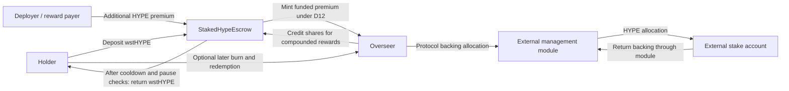

# StakedHypeEscrow Specification

Status: **Draft v0.33 — nominal request cap removed**

Date: 2026-09-18

Repository baseline: `b43fcc9`

This document specifies a proposed `StakedHypeEscrow` (SHE). It distinguishes confirmed requirements from proposed defaults and unresolved decisions. Requirements stated under a proposed default remain provisional until that decision is accepted. A draft implementation is included in `src/StakedHypeEscrow.sol`, with a mainnet deployment script in `script/StakedHypeEscrowDeploy.s.sol`; no live deployment is verified here. Local integration and bounded stateful tests in `test/integration/She*.t.sol` and `test/invariant/SheAccounting.t.sol` cover funding, surplus allocation, withdrawal requests and cancellation, slashing behavior and the acceptance criteria below. These do not establish exhaustive or live-deployment validation.

## 1. Purpose

stHYPE can allocate protocol backing across staking modules, including `StakingModuleExternalManagement`. An externally controlled stake account can commit that backing to deployer activities that earn an additional premium but restrict how quickly HYPE can return to the protocol.

SHE lets holders voluntarily lock wstHYPE in exchange for a pro-rata share of additional yield. Its purpose is to reduce withdrawal pressure from participating holders while longer-duration stake remains committed.

SHE is a **liquidity junior tranche**. It changes access to liquidity; it does not introduce a first-loss tranche, insure principal, or isolate deployer slashing from other stHYPE holders.

### Confirmed requirements

- SHE is a separate contract named `StakedHypeEscrow`.
- SHE is deployed behind an upgradeable proxy, following the existing stHYPE protocol's `TransparentUpgradeableProxy` and `ProxyAdmin` pattern.
- Preview-prefixed simulation functions live in a separate `StakedHypeEscrowLens` contract for off-chain integrations, keeping them outside the main escrow implementation.
- Users voluntarily deposit and lock wstHYPE.
- Participants receive additional yield pro rata, compounded into wstHYPE held in SHE.
- Funded premiums stream over a configured period. Only active balances earn the shares released during that period.
- The amount reserved for a withdrawal stops earning additional SHE yield when the request is created. Previously compounded yield is included in the balance available to request.
- The request owner can cancel an entire pending withdrawal before or after maturity while SHE is unpaused. Cancellation returns its reserved raw shares to active ownership at the current pool price. Requests cannot be amended, merged, or partially cancelled; later withdrawal requires a new request and cooldown.
- At creation, an individual withdrawal request must contain at least one wstHYPE wei and have a positive current nominal stHYPE value. SHE imposes no nominal upper bound; a user may request their full position or split it into multiple independent requests.
- A user must first request withdrawal. After the cooldown fixed at request creation, anyone may execute it and SHE transfers the full wstHYPE payout to the stored request owner. The executor cannot redirect or reduce that payout. The owner can hold it, use it elsewhere, swap it, or independently redeem through Overseer.
- Cooldown must be between one second and 180 days, inclusive; initialization and the default-admin setter reject values outside this range. Reward duration is likewise bounded from one second through 7 days. Updates apply only to subsequently created requests or funded streams.
- Thirty days is the working cooldown example; the production cooldown remains to be selected.
- Either `MANAGER_ROLE` or `DEFAULT_ADMIN_ROLE` can pause or resume deposits, withdrawal requests, cancellation and withdrawal execution together. This global control is intended for security incidents, not routine withdrawal management or selectively delaying requested or matured withdrawals. It preserves existing request records and maturity timestamps.
- Either `MANAGER_ROLE` or `DEFAULT_ADMIN_ROLE` can recover unrelated ERC20 tokens mistakenly sent to SHE. Native HYPE and the configured stHYPE/wstHYPE tokens, including surplus, are excluded.
- Slashing remains a shared stHYPE risk; SHE does not preferentially absorb losses.
- SHE is fully decoupled from `StakingModuleExternalManagement` instances. Stake allocation and any desired relationship to escrow participation are decided off chain, case by case. SHE imposes no coverage ratio or module allocation policy.

### Scope

The initial design covers custody, deposit accounting, compounded rewards, withdrawal requests, delayed wstHYPE transfers to the owner, and manager controls. Negotiating deployer payments, selecting and sizing external allocations, operating markets, and performing HyperCore stake recalls remain external responsibilities. SHE has no module registry, module-specific balances, exposure oracle, or allocation/recall hooks.

## 2. Design decisions

### Confirmed decisions

| ID | Decision | Confirmed behavior |
| --- | --- | --- |
| D1 | Pause scope | Global security pause blocks deposits, withdrawal requests, cancellation and execution together; either manager or default admin can pause or resume. |
| D2 | Extra yield after a request | The reserved amount stops earning additional SHE yield immediately at request creation, including throughout cooldown, maturity and pauses. Ordinary stHYPE yield and losses continue while its shares remain held. |
| D3 | Reward delivery | Compound additional yield into wstHYPE retained in SHE; no separately claimable HYPE reward. |
| D4 | Module independence | SHE is fully decoupled from external-management modules. Allocation and coverage decisions are off chain and case-specific, with no ratio prescribed by this specification. |
| D8 | Duration governance | The default admin may set cooldown from 1 second through 180 days and reward duration from 1 second through 7 days. New requests and streams snapshot the current value; existing request maturities and stream schedules remain unchanged. |
| D7 | Withdrawal resolution | A pending request can be executed by anyone after maturity or cancelled by its owner before or after maturity. Both outcomes are terminal. Owner, raw shares and timestamps remain fixed; cancellation credits newly priced active units and requires a fresh request for a later withdrawal. |
| D9 | Premium timing | Stream each funded premium over a configured period. Only active balances earn during that period. |
| D10 | Deployment architecture | An upgradeable implementation behind OpenZeppelin `TransparentUpgradeableProxy`, with upgrades managed through its separate `ProxyAdmin`, consistent with the existing protocol contracts. |
| D16 | Off-chain helpers | Move preview-prefixed simulation functions into `StakedHypeEscrowLens`, whose sole purpose is read-only integration helpers. |
| D17 | Owner asset return | Transfer wstHYPE directly to the request owner. No chosen recipient, automatic burn or automatic HYPE redemption. |
| D18 | Request discovery | Track request IDs off chain from `WithdrawalRequested` events; no on-chain per-owner enumeration or pagination. |
| D19 | Donations and withdrawal leftovers | Credit surplus raw shares pro rata to all active units, including the seed, while any user units remain. With no units outside the seed, retain new surplus in the global reward reserve for a future positively funded stream. |
| D20 | Request sizing | Permit full or partial requests and multiple independent requests per owner, each with its own cooldown. Splitting a large position is optional. Final exit follows D17. |
| D21 | Request value minimums | At creation, reject a current nominal stHYPE value of zero or a request below one wstHYPE wei. There is no nominal upper bound. Execution checks a positive wstHYPE amount and the caller's wstHYPE minimum, with no nominal `uint88` limit. |

| D15 | Permanent bootstrap seed | Allocate 1,000 units from the first successful deposit to `address(1)`. Reject deposits benefiting that address and all withdrawal requests from it. Include its units and backed assets in pricing forever; retain new emissions and surplus in `R` whenever no user units remain. |

### Remaining choices and proposed defaults

| ID | Decision | Proposed starting point / alternatives |
| --- | --- | --- |
| D5 | Reward pool structure | **Proposed:** one common active pool for all SHE participants, with a separate accounting bucket for requested withdrawals. Neither bucket is linked to any module or deployer. |
| D6 | Position ownership | **Proposed:** a non-transferable internal balance; no receipt ERC-20 or position NFT. A transferable claim could create a secondary market exit, while still keeping protocol backing locked. |
| D11 | Clock behavior during pauses | **Proposed:** elapsed wall-clock time continues to count; pausing blocks execution without extending `eligibleAt`. Freezing clocks would need separate confirmation. |
| D12 | Reward funding interface | **Proposed:** a payable funding function atomically calls `Overseer.mint(address(SHE))` and schedules the measured raw shares received. Accepting already minted wstHYPE is an optional additional funding route, not required by the confirmed reward-delivery choice. |
| D13 | Reward schedule administration and fees | **Proposed:** no additional SHE fee. Duration governance follows confirmed D8; select the remaining schedule/top-up rules, late-payment policy and any treasury share. Schedule changes must preserve accrued rewards and existing funding commitments. |
| D14 | Deployment governance configuration | The mainnet script selects the README protocol timelock as `ProxyAdmin` owner and the protocol multisig as SHE default admin, with a 2-day admin-transfer delay. Manager and reward-distributor addresses remain environment inputs. The existing timelock's upgrade delay is not set by this script; actual deployed governance still requires verification. |

Sections below implement D1–D4, D7–D10 and D15–D21 as confirmed requirements and use the remaining proposed defaults to make the design reviewable. The remaining product defaults are not recorded as user-approved decisions; D14 records the selected script governance and the deployment inputs still to be supplied.

### Concrete choices in the current draft implementation

The implementation uses the proposed common pool, non-transferable internal units, partial and multiple requests, owner-only cancellation, permissionless execution of matured requests, and owner-only wstHYPE payouts. Cooldown and reward duration are initialized parameters with default-admin-only setters. Cooldown must be from 1 second through 180 days (15,552,000 seconds), and reward duration from 1 second through 7 days (604,800 seconds). Initialization and setters reject zero or longer values with `StakedHypeEscrow__InvalidConfiguration`. Elapsed time continues during pauses. Deployment also selects the operational accounts and default-admin transfer delay.

The [mainnet deployment script](script/StakedHypeEscrowDeploy.s.sol) requires chain ID `999`, uses the production stHYPE, wstHYPE and Overseer proxies listed in README, and initializes a 30-day cooldown and 23-hour reward duration. It requires nonzero operational role addresses and at least 0.01 wstHYPE in the deployer's wallet before broadcasting. It deploys and initializes the SHE proxy atomically, then approves and deposits exactly 0.01 wstHYPE for the deployer before deploying the Lens. These are separate transactions, so first-depositor ordering is not guaranteed. `SheDeploy.t.sol` checks the script's configuration, custody, seed allocation and preflight rejections with local protocol implementations at those addresses; it does not verify live dependencies or timelock state.

**Known design choices for mutable durations:** `setCooldown(uint64)` and `setRewardDuration(uint64)` are callable only by the current `DEFAULT_ADMIN_ROLE`, are protected by the reentrancy guard, and remain callable while SHE is paused. They update only configuration and emit `CooldownSet` or `RewardDurationSet`; they neither checkpoint rewards nor change accounting, requests, stream state or pause state. Token/Overseer references still have no setters.

A request stores `eligibleAt = requestedAt + cooldown` when created. Increasing or decreasing cooldown cannot delay or accelerate that request, including matured or paused requests. Active balances have no deposit-time cooldown guarantee: even previously deposited assets use the setting in force when the new request is created on chain. Requests submitted around an admin update can receive different cooldowns depending on transaction ordering; the request API does not include a maximum-cooldown parameter. Integrations should display the current setting before submission and the emitted/stored maturity after confirmation.

A funded stream stores its own start/end timestamps. Updating reward duration during a stream cannot accelerate, extend, replace or unlock its remaining funding; `fundRewards` still rejects calls before that stream's original end. The next successful funding uses the latest configured duration, including when it reschedules retained empty-period rewards. Funding submissions around an admin update likewise use transaction-time configuration; the existing funding minimum bounds new shares received, not stream duration. Governance is trusted to choose and communicate prospective terms within the on-chain bounds.

`defaultAdminDelay` controls transfer of the `DEFAULT_ADMIN_ROLE`; it does not delay the current administrator's security pause, duration updates or token rescues, grants or revocations of manager/distributor roles, or ProxyAdmin upgrades. Upgrade ownership and any upgrade timelock are separate deployment configuration.

Inherited OpenZeppelin governance also exposes cancellation of a pending admin transfer, scheduling and rollback of default-admin delay changes, and role renunciation. A pending admin can accept only **after** the scheduled timestamp (`schedule < block.timestamp`), unlike withdrawal execution, which permits equality with `eligibleAt`. Increasing the admin delay waits the lesser of the new delay and five days; decreasing it waits the difference between the current and new delays. The new delay becomes effective only after that schedule and affects subsequently scheduled transfers; an already scheduled transfer keeps its timestamp. Rollback cancels a pending delay change but does not undo one already effective. Renouncing the default-admin role first requires scheduling a transfer to the zero address and passing its delay; it leaves no default admin. `owner()` on SHE reports this default admin, separately from the governance owner of its `ProxyAdmin`.

There is one reward stream at a time, starting at funding and lasting the reward duration configured at that time. Funding/top-ups are rejected before the previous stream ends. At or after its end, the distributor can combine all undistributed reserve with new HYPE funding in a fresh stream; new HYPE funding must be positive, even if retained funding is positive. The first deposit funds the permanent ownership seed and must precede reward funding and public checkpointing. There is no additional SHE fee, arbitrary-call endpoint, or asset allowance granted by SHE. The token rescue endpoint is limited to unrelated ERC20 tokens; native HYPE and both configured staking tokens are excluded. Direct token transfers and withdrawal leftovers follow D19, including owner donations after receiving their wstHYPE.

Donations and withdrawal leftovers are shared pro rata by active ownership units; they have no separate owner claim and mint no new units. When the active pool is empty, these shares join the global undistributed reward reserve and require a future positively funded stream for distribution. Deposits and requests checkpoint surplus before changing active ownership, so newly entering units cannot capture earlier donations. Deposit beneficiaries must be nonzero and cannot be SHE itself or `SEED_OWNER = address(1)`. The seed cannot request withdrawals, even if a call were made from that address.

Request creation checkpoints rewards and requires the reserved raw shares' current nominal stHYPE value to be at least one wei. SHE imposes no nominal upper bound on a request. Each request must reserve at least `1e6` raw shares so it can return a positive wstHYPE amount. Execution transfers `floor(rawShares / 1e6)` wstHYPE base units to the owner. SHE makes no direct Overseer or nominal stHYPE conversion call during execution. The supported wrapper transfer still invokes token-internal nominal conversion for its transfer event and remains subject to that dependency's arithmetic and transfer restrictions. Appreciation or slashing changes the tokens' HYPE value, not the quoted number returned; it can still affect whether the dependency transfer succeeds.

**Operational supply assumption:** for this design, assume HYPE's maximum supply is `1_000_000_000e18` wei and correct upstream minting/backing accounting keeps nominal stHYPE supply within that ceiling. This is an external operational assumption, not a supply limit enforced by SHE.

The former nominal request creation cap is removed. The previous execution-time `uint88` limit belonged to the automatic Overseer burn route and no longer applies to SHE withdrawals. Any later owner-initiated redemption remains subject to Overseer's own limits.

**Ownership-unit representability with the permanent seed:** after the first deposit, total ownership units are at least 1,000. Under the operational one-billion-stHYPE supply ceiling and correct upstream conversion/accounting, SHE's active assets cannot be worth more than that supply. The nominal value of one ownership unit is therefore at most `1_000_000_000 / 1000 = 1_000_000 stHYPE`; nominal rounding cannot increase that bound. DEV-02's former concern about a single unit exceeding the request cap no longer applies because SHE has no request upper bound.

The seed does not guarantee that every dust position meets the nominal request minimum or the one-wstHYPE-wei transfer minimum. The supply ceiling remains an operational assumption, not a supply limit enforced by SHE.

**Yield context:** requested raw shares stop earning additional SHE rewards while retaining ordinary stHYPE yield and loss exposure. The wstHYPE payout quantity is fixed at request creation; its eventual HYPE value is not fixed. Requests do not expire, and owner delay or SHE pauses can extend the wait beyond cooldown.

**Confirmed surplus-attribution policy:** snapshot held raw shares before the transfer and require an exact debit of `amountWstHype * 1e6`. Remove the entire request from `Q`; allocate its remainder below `1e6` raw shares, plus any pre-existing surplus, under D19. All other requests, active assets, reward reserves and unprocessed donations stay backed.

## 3. Existing integration behavior

The following facts were checked against the repository baseline, not a live deployment:

1. **wstHYPE and stHYPE expose the same underlying share ownership.** `wstHYPE.balanceOf(account)` is `stHYPE.sharesOf(account) / 1e6`. A wstHYPE transfer moves raw stHYPE shares. SHE returns those shares through the wstHYPE transfer interface.
2. **Overseer burns the caller's balance.** `Overseer.burn(to, amount)` burns `amount` in stHYPE balance units from `msg.sender` and creates a burn request whose HYPE recipient is `to`. An owner may choose this path after receiving wstHYPE; SHE does not call it during withdrawal.
3. **The request-time wstHYPE amount is not a fixed HYPE promise.** Its stHYPE equivalent changes with the protocol's exchange rate. SHE pays a fixed wstHYPE quantity; any later redemption uses the protocol rate then.
4. **Burning and receiving HYPE are separate steps.** `Overseer.redeem(burnId)` is publicly callable and sends HYPE to the stored recipient when the burn is redeemable. Eligibility depends on cumulative queue liabilities, available HYPE, protocol fees, slashing accounting, and protocol pause state. `burn` does not start an on-chain seven-day timer in Overseer.
5. **Loss exposure continues in the protocol queue.** Overseer applies its cumulative slash factors to pending burns. SHE must not promise the original burned amount as a guaranteed final payout.
6. **An existing burn boundary remains relevant.** stHYPE burns above `preSyncSupply` can revert despite sufficient displayed balance. Recovery requires a successful authorized rebase after the sync interval, subject to the existing protocol checks. This burn boundary does not apply to SHE's wstHYPE transfer.
7. **SHE custody does not allocate additional backing.** Depositing existing wstHYPE changes who holds its shares. Overseer and its manager still determine underlying stake allocations.
8. **The immediate-redemption route can create two burns.** `burnAndRedeemIfPossible` creates one burn when the whole amount is immediately redeemable or none is; with partial availability it creates and redeems a first burn and queues a second. Its single return value is the last burn ID, not necessarily the only ID. `burnCount()` and burn records support identifying the complete result.
9. **Compounding HYPE can mint shares directly to SHE.** `Overseer.mint(address(SHE))` credits stHYPE shares that are also visible through wstHYPE. Its return value is the input HYPE amount, not minted wstHYPE; SHE must measure received raw shares. Minting remains subject to the existing token and pending-slash/pause checks.

SHE must not be registered as a staking module or report its wstHYPE as new HYPE backing: that backing is already counted by the protocol. Under D12, HYPE reward funding enters Overseer through an ordinary mint and receives corresponding shares for SHE; it is not an unbacked credit or a common rebase donation.

## 4. Architecture and ownership



Under D5–D7, SHE records a non-transferable balance for each beneficiary. Deposited principal remains in SHE until returned to the owner through an eligible withdrawal. There is no manager-controlled lending, rehypothecation, arbitrary execution, or principal-transfer function in this design.

Compounded rewards become part of the beneficiary's active wstHYPE entitlement and follow the same request, cooldown and pause rules as deposited principal. The diagram's module branch describes the existing protocol only; SHE has no direct calls or queries to modules and no dependency on a particular module instance. Existing Overseer operations can still read their registered modules as part of ordinary protocol accounting.

The SHE manager and Overseer's manager are separate authorities, even if governance assigns them to the same organization. Granting an SHE role does not grant an Overseer, staking-module, stHYPE, or wstHYPE role.

### Proxy, initialization and upgrades

- Deploy the `StakedHypeEscrow` implementation behind OpenZeppelin `TransparentUpgradeableProxy`, using the repository's existing dependency and deployment pattern. The proxy address is the stable SHE address: users approve and deposit into it, it holds assets and all SHE state, and it calls Overseer.
- The implementation constructor calls `_disableInitializers()`. A one-time `initialize(...)` configures the proxy's token/Overseer references, initial roles, cooldown and reward settings. Proxy-specific configuration belongs in initialized storage, not implementation-constructor state.
- Supply encoded initialization calldata to the proxy constructor so deployment and initialization are atomic. The deployed SHE proxy must not be left publicly uninitialized.
- Execute the first successful deposit during or immediately after deployment to establish the permanent seed before funding rewards or calling the public checkpoint. If the intended depositor must be first, deploy, initialize and deposit within one transaction; separate transactions permit another account to deposit first. The first depositor receives no administrative authority. Initialization itself does not allocate seed units or pull funds.
- In the checked-in OpenZeppelin implementation, the proxy constructor creates a dedicated `ProxyAdmin` owned by its `initialOwner` argument. Set that argument to the intended upgrade-governance owner selected under D14. SHE's operational roles are initialized separately; holding or transferring its `DEFAULT_ADMIN_ROLE` does not confer or transfer `ProxyAdmin` ownership.
- Route implementation upgrades through `ProxyAdmin.upgradeAndCall`, authorized by its owner and any governance timelock selected under D14. The manager and reward-distributor roles have no upgrade power solely by virtue of those roles.
- Follow the newer protocol contracts' ERC-7201 namespaced-storage convention with a dedicated SHE namespace, such as `stHYPE.storage.StakedHypeEscrow`, and upgradeable base contracts where applicable. SHE is in development and maintains no storage or ABI compatibility with earlier drafts. Incompatible draft changes require a fresh deployment; no migration from an earlier draft is provided.
- For future production upgrades, validation must preserve token custody, user ownership, pending requests, reward commitments and the accounting in this specification. Upgrading a production deployment must preserve its storage layout or use an explicitly validated migration. This requirement does not make earlier development drafts upgrade-compatible.

The restrictions on ordinary SHE roles describe the specified implementation. Upgrade governance is additionally trusted to preserve user ownership and the agreed withdrawal/reward rules when replacing that implementation. Under confirmed D8, the default admin may update the bounded cooldown and reward duration for future requests and streams. Existing requests and streams remain fixed under these setters; upgrade governance remains separately trusted to preserve them.

### Read-only integration lens

`StakedHypeEscrowLens` is a separate stateless contract deployed directly, without proxy storage, administrative roles, custody or state-changing entrypoints. Each helper takes the SHE **proxy address** as its first argument and reads the escrow's existing public getters. One lens can serve multiple compatible escrow instances. SHE never calls or stores the lens, so deposits, rewards and withdrawals do not depend on it being deployed or available.

The four `preview*` functions exist only on the lens. The escrow retains its configuration, account, accounting, reward and individual-request getters, and exposes its reentrancy guard through `isLocked()`. Request discovery is handled off chain from events, with no enumeration helper on either contract. SHE exposes `quoteEntry(maxRawShares, activeRawShares, totalOwnershipUnits)` as a public pure function. It uses the fixed `RAW_SHARES_PER_WSTHYPE_WEI` constant (`1e6`) to round the accepted charge; there is no quantum argument. Deposits call it internally. The lens reads current accounting from the target escrow and calls that escrow's `quoteEntry` externally, so pricing remains in SHE. The helper uses caller-supplied totals without reading escrow state; `maxRawShares` must be expressed in raw shares and divisible by `1e6`. The lens extraction itself does not change SHE's storage layout or the economics of any user action.

`IStakedHypeEscrow` declares the public escrow operations, shared types, events and errors. The implementation follows `StakeAccountManager` conventions for descriptive names, explicit amount units, uppercase enum members, NatSpec and positive custom-error `require` guards. The lens delegates entry quotes to the escrow through this interface. The interface defines the current development draft only; integrations must use matching SHE and Lens ABIs.

Integrations must change the target address from SHE to the lens and prepend the SHE proxy address to the existing preview arguments. A lens deployment is compatible with the current draft's getters and accounting semantics; later SHE upgrades that change these semantics may require a new lens deployment.

`SHE.isLocked()` is an external view returning the existing reentrancy guard status. It is true while any SHE `nonReentrant` operation is in progress, including any callback from an external dependency. The supported wstHYPE transfer does not call the owner's native receive function. Third-party contracts can reject sensitive reads when this flag is true, before consuming SHE or lens values that may reflect intermediate accounting. The getter remains callable while locked and does not itself reject reads or add storage. It is false after a guarded operation succeeds or reverts. It reports only SHE's guard: later standalone `Overseer.redeem` calls do not enter it.

## 5. Deposits and compounded balance accounting

The proposed accounting separates **active ownership units** from **reserved raw stHYPE shares**. Active ownership units are internal SHE ledger entries, not wstHYPE units and not a transferable token. Raw stHYPE shares are the underlying asset quantity; one wstHYPE base unit corresponds to `1e6` raw shares.

Let:

- `A` = raw shares assigned to the active pool, including the permanently backed seed and rewards already released to all its units;
- `U` = total active ownership units, including exactly 1,000 seed units after first issuance, with `u[user]` assigned to each beneficiary;
- `Q` = raw shares reserved in all unsubmitted withdrawal requests;
- `R` = funded reward shares not yet released, including undistributed emissions and surplus retained while the active pool is empty;
- `g = 1e6` = raw shares transferred by one indivisible wstHYPE base unit, i.e. one wstHYPE wei.

Before first issuance, `U == 0` and `A == 0`. Afterwards, `U >= 1000` and `A > 0` permanently. The pool is **empty of users** when `U == 0` or `U == 1000`; throughout this specification, an empty pool includes this seed-only state. `U > 1000` means user units remain.

**Bootstrap requirement:** `fundRewards` and public `checkpointRewards` cannot succeed before the first deposit. With otherwise valid inputs and functioning dependencies, they revert with `StakedHypeEscrow__AccountingInvariant`, preserving the entire transaction state, including any attempted mint, HYPE transfer, stream update and surplus recognition. Their existing authorization, input and dependency checks still apply and can fail earlier. The backing postcondition requires `U >= 1000`, `A > 0`, exactly 1,000 seed-owner units and enough held raw shares for `A + Q + R`. The first deposit establishes this state before checking that postcondition. Its internal checkpoint must still accept the pre-seed state: unsolicited tokens received before bootstrap go into `R`, remain excluded from entry pricing, and become persisted only with a successful deposit. Views may expose that surplus before bootstrap. Seed-only pools after bootstrap may continue funding and checkpointing normally.

With `U > 0`, an active owner's current raw-share entitlement is `floor(u[user] * A / U)` after accounting for rewards released to the current timestamp; with `U == 0`, every active entitlement is zero. Its wstHYPE display value divides raw shares by `1e6`. As extra rewards move from `R` into `A`, each active unit represents more wstHYPE without a per-user claim or mint of new ownership units.

### Deposit

A depositor approves SHE to transfer **up to** a specified amount of wstHYPE and selects a nonzero beneficiary. SHE checkpoints scheduled rewards and surplus shares before calculating the quote. The input is a spending limit; the actual accepted deposit is returned and emitted, and may be smaller. Unspent tokens stay in the depositor's wallet and never become escrow principal.

For an existing active pool, use the pre-deposit `A > 0` and `U > 0`:

```text
d = maxAmountWstHype * g                 // offered maximum, in raw shares
n = floor(d * U / A)                    // ownership units to issue
c = ceil(n * A / U)                     // raw shares needed for those units
a = ceil(c / g) * g                     // actual charge, rounded to transferable wstHYPE units
amountWstHypeAccepted = a / g
```

- Reject `n == 0`. Enforce the caller's `minOwnershipUnits` and `minAmountWstHypeAccepted`; a caller can require the full offered amount by setting the latter equal to the maximum.
- Pull only `a / g` wstHYPE base units. Measure received raw shares and require exactly `a`; an unexpected transfer delta reverts rather than changing the quoted unit issuance.
- Increase `A` only by `a`, and increase `U` and the beneficiary's units by `n`. The difference `d - a` remains outside SHE. It must never be credited to `A`, distributed as a reward, or silently forfeited.
- `a <= d` follows from the formulas and the fact that `d` is a multiple of `g`; enforce the spending limit as a postcondition as well.
- On first issuance (`U == 0`), require `A == 0`. For offered raw shares `d > 1000`, quote `n = d - 1000` units for the beneficiary and charge `a = d`. Allocate exactly 1,000 of the backed units to `SEED_OWNER`; increase total units by `n + 1000`. A zero or too-small offer quotes zero units/charge. Require the initial beneficiary entitlement `stHYPE.sharesToBalance(n)` to be at least one nominal wei and `n >= g`; this conversion is checked at execution, not assumed from a fixed wstHYPE amount. At a 1:1 rate, one wstHYPE wei is insufficient and two are sufficient. Both deposit minima apply to the net beneficiary units and actual charge. Failure rolls back the checkpoint, seed allocation, transfer and events.
- `quoteEntry` is pure and returns the net first-user units without checking a live nominal conversion. `SHELens.previewDeposit` applies the initial nominal and wstHYPE transfer minima and returns `(0, 0, maxAmountWstHype)` when it is not met. For admissible first deposits, its units, charge and unspent amount match execution. General quotes still do not promise success across transfer restrictions, caller minima or subsequent state changes.
- A refill uses the existing `A / U`, including the retained seed entitlement. It neither reissues the seed nor resets the price to one raw share per unit. `Q` and `R`, including donations and emissions retained while empty of users, are excluded from entry pricing and cannot be claimed retrospectively.
- Third-party deposits cannot reset an existing request's cooldown or alter its owner.

This replaces the original rule that credited the **entire offered amount** to the active pool despite rounding unit issuance down. Merely increasing unit precision or adding a minimum-output argument does not replace the actual-charge rule.

### Request accounting

To request withdrawal of `x` active ownership units, checkpoint rewards and calculate `q = floor(x * A / U)` from the pre-request totals. Require `q >= 1e6`, `q >= minRawShares` and a positive current `stHYPE.sharesToBalance(q)` before burning those units, subtracting `q` from `A`, and adding `q` to `Q`. There is no nominal upper bound. Rejection rolls back the checkpoint and leaves ownership, accounting and request IDs unchanged. The final user's full request receives that user's proportional entitlement if it satisfies these minimums; the seed retains the remaining active shares. A position below either value minimum cannot currently be requested. Queued claims and unreleased rewards remain separate.

The resulting request has a fixed raw-share amount, owner and timestamps. Its status moves from `REQUESTED` to `EXECUTED` on a successful wstHYPE transfer, or to `CANCELLED` when its owner rejoins the active pool. Both outcomes are terminal; failed operations leave the request unchanged and retryable. The reserved shares receive no additional SHE rewards while requested, while remaining active units continue compounding. A partial request can therefore exclude only part of a user's position. The request API uses ownership units so an exit can include all previously compounded rewards without pretending that one ownership unit remains equal to one wstHYPE unit.

### Cancellation accounting

For `cancelWithdrawal(requestId, minOwnershipUnits)`, require the caller to own a `REQUESTED` withdrawal and require SHE to be unpaused. Maturity is irrelevant. Checkpoint rewards and donations **before** adding the returning shares to active ownership. With the request's fixed raw shares `q`, and the checkpointed active pool `A > 0`, `U >= 1000`:

```text
n = floor(q * U / A)
require n > 0 and n >= minOwnershipUnits
Q -= q
A += q
U += n
u[owner] += n
request.status = CANCELLED
```

Return and emit `n`. The original units removed at request time must not be restored: they can now represent more assets because incumbents earned premiums and donations while the request was reserved. All `q` raw shares return, including sub-wstHYPE-wei fractions, without any token transfer, allowance, mint, burn or native HYPE movement. Request-creation nominal-value and transfer-quantum limits are not reapplied to this internal accounting movement. `Q` for other requests, token custody and upstream liabilities are preserved.

Issuance rounds down, so the active share price cannot decrease. The returning units' immediate raw entitlement is `floor(n * (A + q) / (U + n)) <= q`; cancellation followed by a new request cannot create a larger claim at unchanged state. Unlike deposits' transferable-charge rounding, cancellation returns the whole reserved amount. Its integer entitlement rounding loss is `ceil((q * U - n * A) / (U + n))`, which can exceed one wstHYPE wei when a single ownership unit is valuable. The caller should choose `minOwnershipUnits` using the current quote. A zero-unit quote reverts even with a zero minimum and leaves the original request available for execution.

A seed-only pool keeps its existing seed shares and exactly 1,000 seed units. Checkpointing retains emissions and donations from the empty period in `R`; returning shares are priced against the seed's existing `A/U`, without reissuing a seed or retrospectively awarding retained rewards. Once cancellation succeeds, the new units earn future emissions and donations on the same terms as other active units.

### Conservation and rounding

- Raw shares held by SHE must cover `A + Q + R`. Any excess is assigned to `A` when `U > 1000`, or to undistributed `R` when no user units remain (`U == 0` or `U == 1000`). Views include this allocation; checkpoints persist it. Completed asset-accounting operations account for all held shares.
- `U` equals the sum of all owner units, including the seed. Before first issuance, both `A` and `U` are zero and the seed owns zero units. After issuance, the seed owns exactly 1,000 units and `U >= 1000`; when all users leave, the positive remaining `A` belongs to the seed. Claims and reward reserves remain in their own buckets.
- A direct token transfer issues no ownership units. It raises the active conversion rate for existing holders, or joins undistributed `R` when empty. Entry pricing includes prior donations so new deposits cannot capture them retrospectively.
- Ordinary stHYPE rebases change the HYPE value of each asset bucket without changing their raw-share quantities or SHE ownership units.
- For an existing-pool deposit, the rounding transfer in economic entitlement from the depositor to all incumbents together is strictly less than `g` raw shares: one wstHYPE wei (`1e-18 wstHYPE`). Converting the newly issued units back to integer raw shares at the same state gives a shortfall of at most `g` raw shares from the actual accepted amount. This arithmetic bound does not waive the withdrawal cooldown.
- Request valuation rounds down by less than one raw share relative to the exact ownership-unit entitlement. The final user's complete request leaves the seed's backed entitlement in `A`. The first deposit instead explicitly funds 1,000 raw shares for the seed, less than one wstHYPE wei. These are per-operation bounds, not a claim of zero cumulative error over arbitrarily many actions.
- Use full-precision multiplication/division with explicit rounding directions and checked range conversions. Arithmetic overflow or failed minimum-output checks must revert atomically. Never round unit issuance up while retaining only the offered asset amount: that can dilute incumbents instead.
- Compounded balances belong to their users. Administration cannot redirect deposited assets, allocated rewards or reserved shares.

### Why the corrected issuance rule has a fixed bound

For an existing-pool issuance of `n > 0` units that charges `a` raw shares, the aggregate change in the existing holders' exact entitlement is:

```text
gain = U * (A + a) / (U + n) - A
     = (a * U - n * A) / (U + n)
```

The deposit charge is the smallest multiple of `g` covering `n * A / U`, so:

```text
0 <= a * U - n * A < g * U
0 <= gain < g
```

A request for `x` units moves `floor(x * A / U)` raw shares into `Q`, with less than one raw share left to other holders. Thus coarse ownership units cannot turn a large unspent deposit remainder into other users' assets. These bounds hold regardless of the exchange rate `A / U`, provided the stated accounting and exact-transfer checks hold.

This proves the local rounding property; it does not establish correctness of reward scheduling, Overseer integration, upgrades or the complete contract. Poor precision can still make an operation unrepresentable or cause it to accept substantially less than its offered maximum. Previews must expose that result, and minimum accepted amounts let the owner require a desired amount or revert.

For the seeded counterexample, one real user unit and 1,000 seed units each represent 100 wstHYPE plus one raw share. An offer of 199 wstHYPE accepts only 100 wstHYPE plus one wstHYPE wei and issues one user unit. The remaining 99 wstHYPE minus one wei stays in the depositor's wallet. The new unit's integer raw-share entitlement is short of the accepted amount by at most one wstHYPE wei; the permanent seed does not replace this actual-charge protection.

The relevant general background is the connection between low share counts and large deposit-rounding losses described in [OpenZeppelin's ERC-4626 documentation](https://docs.openzeppelin.com/contracts/5.x/erc4626#the_attack). The construction here explicitly handles SHE's streamed rewards and raw-share accounting; it is not a claim that SHE implements the ERC-4626 interface.

### Permanent seed and donation resistance

The first successful deposit allocates exactly `SEED_OWNERSHIP_UNITS = 1000` backed ownership units to `SEED_OWNER = address(1)`. The beneficiary receives the remaining units. This allocation is carved out of the first issuance, not added as unbacked units. `SeedLocked` is emitted once alongside `Deposited`; the latter reports the payer's full accepted amount and only the beneficiary's net units. Both events carry final account and pool snapshots as specified in section 11.1. Indexers reconstruct initial unit issuance by including both deltas, or use the final total directly; they must not add the two absolute pool snapshots. Constants expose the seed address and size through SHE's interface; no additional storage fields are needed.

The contract expressly rejects both deposits benefiting `SEED_OWNER` and withdrawal requests called by it. Its unit balance therefore remains fixed at 1,000, and no routine user, manager or distributor action can withdraw its shares or change that balance. This is a contract-enforced rule, not just an assumption about address ownership. Upgrade governance remains separately trusted. The protocol's pre-existing stHYPE reserve is a different mechanism and does not fund this SHE seed.

The initial cost is 1,000 raw shares: `0.001` wstHYPE wei. At a normal first deposit of one whole wstHYPE, the seed receives a fraction `1000 / 1e24 = 1e-21` of the initial units. At the smallest admissible first deposit at a 1:1 upstream rate (two wstHYPE wei), the fraction is 0.05%. The live nominal minimum and transfer-quantum check prevent the seed cost from creating an initial position worth less than one stHYPE wei or one transferable wstHYPE wei at entry. Later deposits and later rate changes may still produce or leave sub-wei positions under the existing request minimum.

**Confirmed reward treatment:** while at least one user unit remains (`U > 1000`), emissions, direct donations and withdrawal leftovers increase `A` for all units, including the seed. The seed's proportional entitlement is permanently locked. With one real user unit and 1,000 seed units, it receives `1000 / 1001` of the new allocations; small initial dilution does not imply a permanently small fraction of future rewards. This is an accepted economic cost of the seed.

When no user units remain, the seed keeps its previously allocated assets but receives no newly elapsed emissions or surplus. Checkpoints advance the stream's processed amount while keeping those emissions in `R`, and add new donations/transfer dust to undistributed `R`. Views apply the same rule. Refilling does not capture this reserve or restart an existing stream. Only a later positively funded stream reschedules retained shares; the seed again participates proportionally while real user units remain. Neither the existing seed entitlement nor the entry price resets when users leave.

The reviewed paths distinguish the following:

- **REJECTED material deposit-rounding theft:** zero-unit issuance reverts without transferring payer assets, and positive issuance charges only for the units actually issued. The existing-pool entry bound remains less than one wstHYPE wei of exact entitlement transferred to all incumbents together. Repeated operations may accumulate indivisible-asset rounding, but cannot transfer the unaccepted portion of an offered deposit to incumbents. Both minimum-output checks and failed first issuance preserve complete state, including unprocessed reserve checkpoints.
- **VALIDATED remaining deposit availability limitation:** a sufficiently high `A / U` can still make small offers unrepresentable. After a two-wstHYPE-wei first deposit and a partial request leaving one user unit, `A = U = 1001` raw shares/units. A donation of 100,100 wstHYPE makes each unit worth 100 wstHYPE plus one raw share: an offer of 99 wstHYPE reverts, while 199 wstHYPE issues one unit and charges only 100 wstHYPE plus one wei. Approximately 100,000 wstHYPE belongs permanently to the seed; the donating one-unit owner can recover only about 100 wstHYPE. The seed retains the high price after that owner exits, so small offers stay inadmissible. An adequate larger offer can still enter. This limitation remains documented for review.

The unseeded example in v0.19 required only a recoverable 100-wstHYPE donation and reset entry pricing after the last user's request. That construction is superseded. The permanent seed substantially raises the capital that must be irrecoverably allocated to exclude a target offer: with one user unit remaining, approximately `1000 / 1001` of a donation belongs to the seed. The minimum donation excluding a 99-wstHYPE offer in the stated seeded state is 99,099 wstHYPE, subject to raw-share rounding. The seed does not establish uninterrupted entry availability or replace the corrected actual-charge formula.

`test/integration/SheSeed.t.sol` checks first issuance and both minima, complete rollback with unprocessed donations, pre-deposit funding/checkpoint rejection, current-rate admission, the seed event and balance, prohibited seed deposits/withdrawals, one-time allocation across refills, proportional seed rewards and seed-only retention. `test/integration/SheDonation.t.sol` checks stored buckets directly, actual custody and payouts, both request orders, small real-user unit balances alongside the seed, repeated entries/exits and direct stHYPE donations smaller than one wrapped wei. `test/helpers/SheAccountingHandler.sol` maintains an independent seed-aware ledger for owners, retained seed assets, pending claims, reserves, streams, wallets and unchanged upstream burn state through mixed stateful sequences; its expectations do not come from SHE/Lens quotes.

Validation of v0.20 passed **127 checks: 81 SHE checks and 46 existing Overseer tests**, using the actual local protocol implementations. Five fuzz tests each ran at least 5,000 cases, and the independent accounting invariant ran 128 sequences of depth 128 (16,384 calls, zero handler reverts). A deliberately broken isolated copy that allocated rewards during seed-only periods failed the exact retained-assets test; the unmodified implementation passed after restoration. These are offline, bounded checks, not live deployment or exhaustive verification.

Files reviewed for this change: `src/StakedHypeEscrow.sol`, `src/StakedHypeEscrowLens.sol`, `src/interfaces/IStakedHypeEscrow.sol`; `test/helpers/SheTestBase.sol`, `test/helpers/SheAssertions.sol`, `test/helpers/SheAccountingHandler.sol`; `test/integration/SheAuthorization.t.sol`, `SheConformance.t.sol`, `SheDonation.t.sol`, `SheLens.t.sol`, `SheLifecycle.t.sol`, `SheReentrancy.t.sol`, `SheSeed.t.sol`, `SheSlashing.t.sol`; `test/invariant/SheAccounting.t.sol`; and this specification. Scope is the relevant implementation/test paths, not a new audit of every dependency. Other Solidity source files and the existing Overseer test file were checked byte-for-byte against the pre-seed snapshot and left unchanged.

This draft is for a fresh SHE deployment. Although no storage fields are added, upgrading an already populated unseeded draft proxy without an explicit migration is unsupported: its state lacks the required seed and has different reward/entry semantics. The populated-proxy upgrade regression starts from a seeded proxy, preserves the seed alongside active positions, roles, streams and pending requests, and continues operating. No deployed dependency contract is changed.

## 6. Withdrawal lifecycle

```mermaid
stateDiagram-v2
    Active --> Requested: Reserve shares; stop extra yield on requested amount
    Requested --> Executed: Cooldown elapsed; checks pass; wstHYPE transferred to owner
    Requested --> Cancelled: Owner cancels; raw shares return to active pool at current unit price
```



`EXECUTED` means SHE has returned wstHYPE to the request owner. `CANCELLED` means its reserved shares have returned to the owner's active position. These statuses are terminal for that request. There is no SHE redemption stage or protocol queue entry created by execution.

### 6.1 Request

`requestWithdrawal(ownershipUnits, minRawShares)` is owner-only and applies the accounting in section 5. Each request fixes its owner, raw-share quantity, `requestedAt` and `eligibleAt`. Its owner can cancel it as a whole; it cannot be amended or merged. The reserved quantity must cover at least one wstHYPE wei and meet the existing nominal stHYPE creation bounds. Requests may cover part of a position; each has its own clock and no expiry.

`WithdrawalRequest` contains only `owner`, `rawShares`, `requestedAt`, `eligibleAt` and `status`, in that order. Execution pays `owner`; there is no separate recipient or upstream burn metadata. Resolution changes only the request status, retaining the owner, quantity and timestamps for later reads. Executed and cancelled records remain readable and cannot resolve again. The compact request occupies three storage slots and the getter returns a five-field tuple. Earlier draft layouts and getter return tuples are unsupported; use a fresh SHE deployment and a Lens built against the current interface.

### 6.2 Cancellation

The owner may cancel the entire pending request before or after `eligibleAt`, subject to the global security pause and their unit minimum. Successful cancellation emits `WithdrawalCancelled(requestId, owner, rawShares, ownershipUnits, account, accounting)`, with the request ID and owner indexed. The request retains its original fields and becomes `CANCELLED`; it cannot be cancelled or executed again. A later withdrawal creates a new ID and snapshots the then-current cooldown. Cancellation provides no route to transfer funds or preserve an old request's maturity for a new withdrawal.

### 6.3 Execution and rounding

`executeWithdrawal(requestId, minWstHypeAmount)` returns `amountWstHype` and requires:

1. SHE withdrawals are enabled.
2. The request exists and has status `REQUESTED`; any caller may execute it.
3. `block.timestamp >= eligibleAt`.
4. `amountWstHype = floor(rawShares / 1e6)` is positive and meets the caller's wstHYPE minimum.
5. The wstHYPE transfer succeeds and its exact raw-share debit matches the amount sent.

Execution always pays the stored owner, regardless of the executor. The caller's minimum is only a revert bound: lowering it cannot lower the fixed payout, and setting it above that payout reverts without changing the request. No executor fee or allowance is granted.

After maturity, the owner no longer exclusively controls execution timing. If third-party execution is included before owner cancellation, the owner receives wstHYPE and cancellation reverts; if cancellation is included first, execution reverts. Cancellation remains owner-only both before and after maturity. Integrations must account for a request being resolved before their transaction is included.

SHE marks the request `EXECUTED`, removes the whole request quantity from `Q`, and calls `wstHYPE.safeTransfer(owner, amountWstHype)`. For held shares `H` and request quantity `q`:

```
amountWstHype = floor(q / 1e6)
transferredRawShares = amountWstHype * 1e6
require(heldAfter == H - transferredRawShares)
remainderRawShares = q - transferredRawShares  // between 0 and 999,999 inclusive
```

SHE checkpoints elapsed rewards and assigns surplus, including that remainder, under D19: active units share it when user units remain; otherwise it joins the retained reward reserve. Other requests, the seed, active balances and stream commitments remain backed. No additional owner residual claim exists.

Execution emits `WithdrawalExecuted(requestId, amountWstHype, owner, rawShares, account, accounting)`, with the request ID and owner indexed. `rawShares` is the entire resolved request, while `amountWstHype * 1e6` is the actual custody debit. It creates no burn, pays no native HYPE, grants no allowance and changes neither token supply nor Overseer liabilities or redemption accounting. The supported wrapper invokes no recipient callback. A token transfer pause, transfer failure, false return, unexpected share debit or failed backing check rolls back the whole execution and leaves the same request retryable. Empty ERC-20 return data is accepted only if the exact share debit also matches.

The ten SHE mutations retain `nonReentrant`: deposit, request, cancel, execute, fund, checkpoint, rescue, pause and both duration setters. Inherited governance keeps its own authorization rules. Fault-injected dependency callbacks test the guard and guarded reads; these are not native-recipient callbacks in the supported withdrawal path.

### 6.3 Owner choices after withdrawal

The owner can hold the returned wstHYPE, transfer it, use it as collateral where supported, swap it on a market, or separately call Overseer to burn/redeem. Those actions are outside SHE and follow their own market or protocol conditions. A later SHE pause cannot restrict wstHYPE already returned. SHE creates no queue priority and promises no HYPE payout date or redemption value.

### 6.4 Timing example

Alice requests the units representing 40 wstHYPE from a 100-wstHYPE active position. Her remaining 60 continues earning SHE premiums; the reserved 40 does not. At maturity, she can receive 40 wstHYPE, subject to SHE pause and token transfer conditions. Ordinary staking yield or loss changes its HYPE value without changing the 40-wstHYPE quantity. Rewards accruing to her remaining active position need their own request and cooldown.

## 7. Additional yield

### 7.1 Funding and conversion

Under proposed D12, an authorized distributor supplies native HYPE through a payable funding function. SHE atomically calls `Overseer.mint(address(SHE))`, measures the raw shares actually received, and adds only those shares to the funded reward reserve `R`. Mint return values and HYPE input amounts must not be treated as wstHYPE amounts. `fundRewards(minNewRawShares)` requires `msg.value > 0` and applies the minimum only to shares minted from this call's HYPE, excluding retained funding. Zero HYPE funding reverts, including when retained funding is positive. Retained funding is combined with newly minted shares in the resulting stream. Each stream snapshots the configured reward duration at funding. Later `setRewardDuration` calls do not change its start, end, funded shares or release schedule.

If minting or schedule validation fails, the entire funding transaction reverts: no unfunded schedule or partial reward credit remains. Existing deposits, requests and matured exits do not require this mint to succeed. Unsolicited native HYPE is not automatically treated as credited reward funding.

Ordinary staking rewards already recognized through module balances continue to flow through stHYPE to all holders. Additional premiums reach SHE through independent funding, without module IDs or module-dependent eligibility. Sending the premium to Overseer through the specified mint adds backing and credits matching shares to SHE. Recognizing it as ordinary staking yield and subsequently removing the backing for SHE is outside this design.

SHE distributes only received share funding. It does not recognize unfunded promised yield as an asset or guarantee an APR. Nonpayment reduces or stops future extra yield without changing existing ownership, funded commitments or withdrawal rules. Commercial payment and recall arrangements remain off chain.

### 7.2 Streaming and automatic compounding

Funded premiums stream over a configured period under confirmed D9. With the proposed conversion-at-funding design, schedules are denominated in raw stHYPE shares, whose wstHYPE amount is stable. Their HYPE value may change with the protocol exchange rate.

For a single schedule with `F` funded shares, start `s` and end `e`, cumulative scheduled release is:

`releasedBy(t) = floor(F * (clamp(t, s, e) - s) / (e - s))`, with `e > s`.

At a checkpoint, calculate the newly elapsed release since the previous checkpoint. When `U > 1000`, move that quantity from `R` to `A`; leave ownership units unchanged. Each owner, including the seed, benefits in proportion to its units. With no user units, retain the emission in `R` while advancing the processed release. An equivalent continuous description is:

`user allocated shares = integral(raw-share emission rate * u[user] / U)`.

At the same checkpoint, measure `surplus = heldRawShares - (A + Q + R)` before allocating it. If `U > 1000`, add surplus to `A` without issuing units or changing the reward schedule. Otherwise add it to undistributed `R`. This includes direct donations and withdrawal leftovers. Surplus retained during an empty interval is excluded from the current stream commitment and first-entry pricing; it joins the next positively funded stream. `RewardsCheckpointed` reports both elapsed stream processing and newly recognized surplus.

- Checkpoint before every deposit, request, or schedule change. Time-based views must include elapsed release even if no transaction has checkpointed it yet.
- New deposits receive units at the current active conversion rate after checkpointing. They cannot capture shares already released to earlier holders.
- Creating a request first includes already released rewards in its valuation, then removes its ownership units. The reserved shares receive no later emissions, regardless of whether the request is cooling down, matured or delayed by a pause.
- Released rewards are immediately part of the active pool and participate in future compounded growth. They require no user claim transaction. Their withdrawal requires an ordinary request and cooldown, and cannot bypass the global security pause.
- When `U == 0` or `U == 1000`, elapsed emissions accrue to neither users nor the seed. Mark them explicitly undistributed within `R` and advance the schedule checkpoint. A subsequent depositor must not capture them retrospectively. Reuse requires an explicit future positively funded period.
- Every schedule is fully backed by shares held in `R`. A new schedule cannot overwrite committed emissions, double-use reserves or reduce rewards already released into `A`. The draft rejects any funding call before the existing stream ends. Once it ends and is checkpointed, all remaining `R` is undistributed and can be scheduled with new funding for a fresh period.
- Use cumulative release and retained precision so repeated checkpointing does not discard each interval's fractional emission. At the end of a period all scheduled shares must be accounted for as allocated or explicitly undistributed.

In storage, `releasedRawShares` means cumulative scheduled release **processed**, including empty-pool intervals, not cumulative allocation to depositors. While a stream runs, its remaining commitment is `totalRawShares - releasedRawShares`; undistributed reserve is `R` minus that commitment. `totalAccounting()` and `rewardState()` include elapsed time consistently, so allocated rewards are not also shown as unallocated reserves. `checkpointRewards()` is permissionless and does not change the allocation rule.

The stream compensates active participation during its configured period. It does not reconstruct entitlement for an earlier unpaid billing period. Payment timing and commercial terms are external to SHE's module-independent accounting.

### 7.3 Asset separation and withdrawal of rewards

There is no separately claimable HYPE or wstHYPE reward. A user's compounded reward is part of their active entitlement and follows the same withdrawal lifecycle as their deposit. Once shares are reserved in a request, both the deposited and compounded portions stop earning additional SHE yield.

`A`, `Q` and `R` refer to disjoint quantities of the same raw-share asset. Releasing rewards moves shares from `R` into `A` without another token transfer or per-user iteration. Requesting an exit moves shares from `A` into `Q`. These movements must not count the same shares twice.

All converted wstHYPE, including active rewards, reserved claims and unreleased reward funding, experiences ordinary protocol rebases and losses through its HYPE value. A fixed raw-share reward schedule does not guarantee a fixed HYPE-denominated reward value.

### 7.4 Slashing and transfer boundaries

Recognized losses change the HYPE value per raw share, not `A`, `Q`, `R`, ownership units, reward schedules or the number of wstHYPE tokens reserved. The wstHYPE execution minimum therefore does not need to change after a loss. A request whose nominal value falls below one HYPE wei can still transfer its reserved whole wstHYPE wei.

Withdrawal no longer calls Overseer or depends on its burn/redemption pauses, `uint88` burn limit, `preSyncSupply` burn baseline, liquidity or module reads. Funding and owner-initiated redemption still depend on the corresponding upstream operations. Token transfer pauses and failures remain relevant to SHE execution. In particular, `wstHYPE.transfer` calls `stHYPE.transferShares`, whose nominal `Transfer` event uses the fixed token's narrow `mulDivDown`: an overflowing raw-shares-times-raw-supply product reverts even when the full-precision quotient would fit. SHE's request and accounting changes roll back with that transfer. An extreme local loss/mint/recovery history reproduces this boundary in `SheDependencyConversion.t.sol`; it is not evidence of an ordinary-operating trigger or a production occurrence. In that tested state, owner cancellation followed by a smaller request and a new cooldown permits settlement. This is a fixture-specific recovery, not a general progress guarantee.

Local negative diagnostics retain the upstream total-loss and zero-cumulative-slash-factor boundaries. They now separately verify successful wstHYPE transfer: zero nominal token supply or a zero cumulative slash factor does not itself stop the supported wrapper from returning shares. This does not restore backing, economic value, minting or HYPE redemption. See `testSlashTotalLossHasNoNormalProtocolRecovery` and `testSlashZeroCumulativeFactorDoesNotBlockWstHypeTransfer` in [SheSlashing.t.sol](test/integration/SheSlashing.t.sol).

### 7.5 Known small-loss accounting edge case and operational trust assumption (DEV-01)

**Accepted decision:** retain the existing audited/deployed Overseer and token implementations and treat the below-threshold loss behavior as a known operational edge case. SHE inherits that behavior without replacement accounting or a promise of unconditional HYPE recovery. This acceptance is specific to DEV-01; the separate total-loss and zero-cumulative-factor boundaries in section 7.4 remain distinct.

Let `S` be the entire outstanding stHYPE supply, `P` the unpaid Overseer burn liabilities, `B` reported protocol backing after protocol fees, and `D = S + P - B` a positive net shortfall. `S` includes shares held by SHE in all three buckets, including requested shares and shares returned to owners until those owners choose to burn them. It is not merely the active SHE pool.

Overseer compares the loss fraction against `minSlashPercentage`, using `S + P` as the denominator and 18-decimal fraction precision. If the loss is below that threshold, it leaves queued liabilities and the cumulative slash factor unchanged; the maximum-slash check also does not run in that branch. Rebase still computes `newSupply = B - P`, approximately `S - D`. Thus remaining token holders can absorb the entire ignored loss even when `maxSlashPercentage` is zero. These formulas describe the mechanism; exact integer rounding remains governed by the existing contracts.

At the initialized minimum of `1e10`, the fraction is `1e-8` (0.000001%). With 10M HYPE of queued claims and only 0.04 stHYPE outstanding, losses of 0.03, 0.04 and 0.05 HYPE are all below the approximately 0.1-HYPE threshold:

| Net shortfall | Known outcome |
| --- | --- |
| 0.03 HYPE | Rebase succeeds with supply 0.01; outstanding token holders lose 75%, totaling only 0.03 HYPE, while queued claims remain unchanged. |
| 0.04 HYPE | Rebase succeeds with zero token supply despite outstanding shares; subsequent ordinary rebase cannot recover normally. |
| 0.05 HYPE | `B - P` underflows; rebase reverts atomically and preserves the previous state. |

**Operational trust assumption:** operators keep ignored shortfalls negligible relative to the remaining circulating supply, rather than considering their size only against total claims. Before an automated rebase in an almost-empty or queue-dominated pool, operators must check that an ignored loss neither consumes the circulating supply nor causes a material holder loss. In particular, an ignored-loss rebase must leave `B - P > 0`. If these checks fail, operators stop the automated rebase and use the existing recovery controls. This preflight is an off-chain operating responsibility, not a new on-chain safeguard; an SHE security pause alone does not prevent an Overseer rebase. Accurate accounting, functioning administrative/rebaser permissions and timely intervention remain trusted dependencies.

**Recovery options:** before a damaging rebase, operators can cover a small verified shortfall through a direct unminted HYPE contribution to Overseer, or lower the minimum threshold and allow the measured loss through the maximum threshold before an authorized rebase. A normal mint or SHE reward funding is not equivalent to an unminted contribution because it also creates token claims. Once a holder-only loss has been applied, a later threshold change does not retroactively redistribute that loss to queued burns. If supply has already reached exactly zero, a donation followed by ordinary rebase is insufficient; recovery can require restored backing, a carefully reviewed corrective token-supply synchronization through existing token administration, and a later ordinary Overseer rebase to refresh the token's burn baseline. Local diagnostics validated these specific recovery paths without an implementation upgrade. Production role availability, exact recovery values, normal pause/timing checks and liquidity must still be established for an actual incident; no automatic or bounded-time recovery is promised.

**Reducing the minimum threshold:** the existing `Overseer.setMinSlashPercentage` administrator function allows a lower value without a contract upgrade. For fixed total claims, the maximum ignored-loss budget falls approximately in direct proportion to that setting:

| `minSlashPercentage` | Fraction of total claims | Approximate ignored-loss boundary per 10M HYPE of total claims |
| --- | --- | --- |
| `1e10` | `1e-8` | 0.1 HYPE |
| `1e9` | `1e-9` | 0.01 HYPE |
| `1e8` | `1e-10` | 0.001 HYPE |

The boundary is not inclusive for ignored losses, and contract rounding applies. Lowering the setting therefore reduces both the possible absolute holder-only loss and the size of the near-empty-supply region exposed to this behavior. Any positive ignored-loss allowance still needs the operating assumption above. A zero setting recognizes every reported positive shortfall, but is not a universal fix for the separate zero-supply, rounding or total-loss boundaries. Smaller settings make smaller accounting shortfalls block minting/redemption and require loss recognition; `maxSlashPercentage = 0` still prevents a recognized negative rebase until the shortfall is covered or governance permits it. Reducing the minimum does not itself approve a larger loss or waive the maximum. A concrete new threshold has not been selected or applied as part of this documentation update.

**Practical likelihood and evidence:** the severe outcomes require almost all claims to have moved into the Overseer queue while only dust remains in circulating supply. They are considered very unlikely in ordinary operation, but plausible during a near-complete withdrawal or wind-down; no measured incident frequency or production occurrence is established. At the read-only snapshot on chain 999, block 45,469,575 (2026-09-09 19:01:06 UTC), outstanding stHYPE was approximately 2.558M, pending burns approximately 5,939 HYPE, and backing after fees exceeded those claims by approximately 143.28 HYPE. The observed minimum was `1e10`, corresponding to an ignored-net-loss boundary of about 0.02564 HYPE at that scale. This was a dated snapshot far from the tail-state preconditions, not a permanent guarantee. The five local follow-up diagnostics established the zero boundary, prevention by prior recognition, unminted top-up recovery, administrative zero-supply recovery and the inability of a later threshold change to undo an already-applied holder loss. They are diagnostic evidence of a known boundary and specific recoveries, not a proof of general exit liveness.

## 8. Global security pause and roles

`setPaused(bool)` controls one global security flag, exposed by `paused()`. Either `MANAGER_ROLE` or `DEFAULT_ADMIN_ROLE` can pause or resume all four user asset operations together, including resuming a pause set by the other role. This is an emergency security mechanism for responding to incidents, not a liquidity-management tool or a way to selectively delay requested or ready-to-execute withdrawals.

| Action | During the global SHE security pause |
| --- | --- |
| Deposit, including first issuance | Blocked |
| Create a withdrawal request | Blocked |
| Cancel a pending withdrawal | Blocked |
| Execute a request, including a matured request | Blocked |
| Advance an existing cooldown | Continues under D11; `eligibleAt` is unchanged |
| Fund rewards | Allowed after the first deposit, subject to funding authorization and ordinary funding checks |
| Checkpoint and compound funded rewards into active balances | Allowed after the first deposit; elapsed emissions continue |
| Update cooldown or reward duration | Allowed for the default admin; existing requests/streams are unchanged |
| Rescue unrelated ERC20 tokens | Allowed for the manager or default admin; native HYPE, stHYPE and wstHYPE are excluded |
| Allocate extra yield to a requested balance | Never allowed, whether paused or unpaused |
| Claim rewards directly | No such exit route exists |
| Redeem a previously submitted Overseer burn | Governed solely by Overseer |

Roles:

- **Administrator (`DEFAULT_ADMIN_ROLE`):** can set the global security pause, rescue unrelated ERC20 tokens, manage SHE role assignments and update cooldown/reward duration within D8's bounds. Duration updates apply immediately to future requests/streams, including requests from already-deposited active balances. Cannot rewrite pending requests or streams, or rescue native HYPE, escrowed stHYPE/wstHYPE, or allocated rewards through ordinary administration functions.
- **Manager (`MANAGER_ROLE`):** can set the global security pause and rescue unrelated ERC20 tokens. Native HYPE and the configured stHYPE/wstHYPE tokens cannot be rescued. Cannot change request ownership, redirect payouts, or waive an individual cooldown. Like any account, the manager can execute an eligible withdrawal for its stored owner.
- **Reward distributor:** funds, converts and schedules premiums within the conservation rules. This role alone grants no pause authority, custody powers over user assets or authority over external staking modules.

**Upgrade governance** is the owner of the proxy's separate `ProxyAdmin`, with any applicable timelock selected under D14. It is distinct from these implementation roles, even if the same governance organization controls both. See section 4 for the initialization and upgrade requirements.

While the security pause is active, requested and matured withdrawals are temporarily blocked along with deposits. It cannot target a particular owner or request, change a request, reset its cooldown, or return its reserved shares to the active pool. After resume, an already mature request can execute immediately under its original maturity and ordinary token-transfer checks, without another SHE cooldown. No maximum pause duration or automatic expiry is implemented; emergency-only use is the operating policy, while either authorized role can restore access.

The setter emits `PausedSet(bool)` and changes only the existing pause flag. It neither checkpoints rewards nor modifies balances, requests, schedules or configuration. The pause guards revert with `StakedHypeEscrow__Paused` before checkpointing or moving assets. Quotes remain informational: callers can read `paused()` even when a deposit or request quote is otherwise valid, and execution eligibility is false while paused.

### 8.1 Mistaken ERC20 recovery

`rescueTokens(token, recipient, amount)` is callable by either the current `DEFAULT_ADMIN_ROLE` or a current `MANAGER_ROLE` holder. It remains available while SHE is paused and shares the escrow's reentrancy guard. The function is nonpayable and makes no native-HYPE transfer. It rejects `address(0)` as the token and rejects both configured stHYPE/wstHYPE addresses with `StakedHypeEscrow__ProtectedToken`, even if their balances include unsolicited donations or rounding surplus. A positive amount and a recipient other than zero or SHE itself are required.

Recovery uses `SafeERC20.safeTransfer`, accepting a successful transfer with no return data and rejecting false-returning tokens or non-contract addresses. Token reverts propagate and revert the entire rescue. There is no arbitrary-call, allowance, or native withdrawal route. The function does not checkpoint rewards or intentionally change ownership units, any accounting bucket, requests, stream progress, pause state or configuration. It does not depend on upstream token/Overseer reads, so unrelated-token recovery remains usable during an upstream outage.

The privileged caller selects the recipient and is trusted to return mistakenly sent unrelated tokens to the appropriate owner. `TokensRescued(token, recipient, amount)` indexes the token and recipient; `amount` is the transfer argument, not a guarantee of the recipient's net receipt for tokens with transfer fees. It is not an accounting event and does not change the pool snapshots used by SHE holdings indexers. Protected token addresses remain fixed in this implementation; proxy upgrades remain a separate trust boundary.

## 9. Independence from staking modules

SHE is fully decoupled from `StakingModuleExternalManagement` instances. Its on-chain dependencies are the selected token/Overseer contracts and its own governance, reward and withdrawal configuration. It can accept deposits, stream funded rewards and process eligible requests without identifying any particular external module or deployer.

Confirmed boundaries:

- No module registry, module allowlist or per-module position/reward accounting.
- No required escrow-to-stake coverage ratio, including no prescribed 1:1 operational target.
- No module exposure oracle, allocation cap, per-deployer maturity matching or automatic recall mechanism.
- No hook from SHE deposits, requests or reward funding into module allocation functions.
- No requirement to change existing Overseer allocation checks or module implementations to enforce an SHE policy.
- No linkage between a user's eligibility for funded SHE rewards and a particular deployer's payment or stake balance. The distributor supplies common reward funding; commercial attribution remains off chain.

The protocol decides external stake allocations, desired liquidity buffers, payment terms, recalls and pause interventions off chain, case by case. SHE may expose its active balances, requested balances and maturities for those decisions, but does not validate or enforce their relationship to external positions.

SHE delays participating holders' access to their wstHYPE until eligible execution. Subsequent holder transfers or Overseer burns follow ordinary token/protocol rules. This creates no additional allocation rule or permanent protocol queue priority.

### External timing context

The official HIP-3 documentation maintains the deployer staking requirement for 30 days after all its markets have halted and permits validator-voted slashing, including during unstaking. The native staking documentation describes a seven-day staking-to-spot queue. Accordingly, a 30-day SHE notice period cannot by itself establish that an active HIP-3 commitment will be liquid when that notice expires. [HIP-3 specification](https://hyperliquid.gitbook.io/hyperliquid-docs/hyperliquid-improvement-proposals-hips/hip-3-builder-deployed-perpetuals), [native staking](https://hyperliquid.gitbook.io/hyperliquid-docs/hypercore/staking).

The HIP-4 deployer API consulted on 2026-09-08 is explicitly marked **testnet-only**. It requires 183 days of deployer staking and no active outcomes before deactivation, describes additive staking requirements, and identifies malformed markets as validator-slashable. These are historical design context, not verified production HIP-4 terms or SHE configuration inputs. Applicable external conditions are evaluated through the protocol's off-chain allocation process. [HIP-4 deployer actions](https://hyperliquid.gitbook.io/hyperliquid-docs/for-developers/api/hip-4-deployer-actions).

## 10. Loss allocation and trust boundaries

Before execution, SHE holds ordinary stHYPE shares in active, requested and reward-reserve buckets. Their HYPE value falls with the same protocol exchange rate as shares held outside SHE. SHE does not restore a depositor's entry value or debit only escrow participants for a deployer loss.

After execution, the owner holds wstHYPE and retains ordinary token yield and slashing exposure. If they later burn, swap or otherwise use it, the corresponding protocol or market determines their resulting position.

Compounded rewards and reward funding already converted to wstHYPE bear ordinary stHYPE loss exposure. Stopping extra yield on a requested amount does not stop its ordinary positive rebases or protect it against negative rebases. Unsolicited, unconverted native HYPE creates no promised user reward entitlement.

SHE inherits dependencies on correct token/Overseer behavior, upgrades, protocol rebase and pause operations, accurate module accounting, and the external account's cooperation in returning stake. In particular, the external-management module documents transit states in which its reported backing is temporarily incomplete; SHE does not repair that accounting dependency.

**Operational module-read assumption:** the existing protocol contracts remain unchanged. Accurate, readable module accounting remains relevant to reward funding, rebase, backing valuation and owner-initiated redemption. It is no longer an execution or execution-preview dependency for returning wstHYPE from SHE. This change does not repair upstream accounting or promise economic recovery or a HYPE settlement deadline.

SHE neither supplies replacement accounting values nor retries a failed helper through a different exit route. A best-effort Lens quote is for display only and is never an input to SHE's accounting, funding or execution. A successful numeric return cannot generically establish economic correctness: accurate token conversions, module accounting and protocol loss recognition remain upstream trust assumptions. Recovery may require the existing authorized rebase/loss/pause operations as well as restoring readable accounting. DEV-01 is accepted under the small-loss accounting and operator recovery assumption in section 7.5; DEV-02 is addressed by the accepted ownership-unit representability assumption above.

## 11. Candidate interface and observable state

Names and signatures are illustrative, subject to the decisions above and repository conventions:

| Operation | Intended behavior |
| --- | --- |
| `deposit(maxAmountWstHype, beneficiary, minOwnershipUnits, minAmountWstHypeAccepted)` | Pull only the bounded charge for units issued; expose the actual accepted amount |
| `requestWithdrawal(ownershipUnits, minRawShares)` | Require at least one transferable wstHYPE wei, a positive current nominal stHYPE value and the caller's raw-share minimum; reserve the compounded entitlement under a new clock and return request ID, with no nominal upper bound |
| `cancelWithdrawal(requestId, minOwnershipUnits)` | Owner-only; return all pending raw shares to active ownership at the current pool price; return units issued |
| `executeWithdrawal(requestId, minWstHypeAmount)` | Transfer whole wstHYPE units to the owner after cooldown and pause checks; return the amount and allocate remainder under D19 |
| `fundRewards(minNewRawShares) payable` | Require the first successful deposit and positive new HYPE funding, mint it, and stream it together with retained undistributed reserve after the prior stream ends |
| `checkpointRewards()` | After the first successful deposit, permissionlessly process elapsed emissions and surplus shares |
| `rescueTokens(token, recipient, amount)` | Manager or default admin recovers unrelated ERC20 tokens; exclude native HYPE and configured stHYPE/wstHYPE, including surplus |
| `setPaused(paused)` | Manager or default admin globally pauses/resumes deposits, withdrawal requests, cancellation and execution for security incidents |
| `setCooldown(cooldown)` | Default-admin only; set 1 second–180 days for future requests without changing existing maturity |
| `setRewardDuration(rewardDuration)` | Default-admin only; set 1 second–7 days for future funded streams without changing an existing schedule |
| `isLocked() view` | Return whether SHE's reentrancy guard is currently entered |
| `quoteEntry(maxRawShares, activeRawShares, totalOwnershipUnits) pure` | Quote issued ownership units and accepted raw shares using supplied totals and the fixed wstHYPE transfer increment |

Views must expose active ownership units, current compounded wstHYPE entitlements, reserved raw shares, reward reserves and schedules, pause state, cooldown configuration, requests and maturity. Conversion previews must distinguish ownership units, wstHYPE, raw shares and estimated HYPE. Deposit previews must show the actual accepted amount and tokens left in the wallet. An execution preview shows SHE status/clock/pause eligibility and the exact whole-wstHYPE quantity. It does not guarantee transfer success or HYPE redemption.

Read-only helpers on `StakedHypeEscrowLens`:

| Helper | Result |
| --- | --- |
| `previewDeposit(escrow, maxAmountWstHype)` | Ownership units, accepted wstHYPE, and unspent wstHYPE |
| `previewRequestWithdrawal(escrow, owner, ownershipUnits)` | Raw shares reserved for the requested active units, including accrued rewards and donations |
| `previewCancelWithdrawal(escrow, requestId)` | Current active-unit issuance for a pending request, including elapsed rewards and donations in pricing |
| `previewExecution(escrow, requestId)` | SHE status/clock/pause eligibility and wstHYPE amount to return |

Previews do not enforce caller authorization where required, caller minima or every token transfer condition. Execution is permissionless; cancellation remains owner-only. `previewRequestWithdrawal` rejects the seed holder and excess owner units. `previewCancelWithdrawal` returns zero for unknown/resolved requests or insufficient shares for a unit, otherwise quoting `floor(q * U / A)`. Like deposit/request pricing, it does not enforce caller authorization or pause eligibility. `previewExecution` returns `(false, 0)` for nonexistent, executed or cancelled requests and otherwise returns `(sheEligible, rawShares / 1e6)` without reading Overseer or nominal token conversion. Request creation requires at least one wstHYPE wei of raw shares. Execution independently rejects a zero payout.

`CooldownSet(uint64)` and `RewardDurationSet(uint64)` expose prospective configuration changes. Event reconstruction must track them in log order after `EscrowConfigured`: derive each request's creation time from its emitted `eligibleAt` and the cooldown in force for that request, rather than the latest configuration. Existing `RewardsFunded` start/end timestamps already describe each immutable stream schedule.

Events must make actual accepted deposits/net user-unit issuance, the one-time `SeedLocked` allocation, requests, cancellations and reissued ownership units, executions and wstHYPE amounts, reward funding/conversion/schedules, and pause/configuration changes reconstructible. Unspent wallet funds must not be emitted as an accepted deposit. There is no reward-claim event or endpoint. Off-chain integrations discover request IDs from `WithdrawalRequested`, which indexes the request ID and owner, and query `getWithdrawalRequest(requestId)` for current state. Request IDs remain unique through the global request counter. SHE maintains no per-owner ID array, pagination endpoint or page-size limit; the lens does not enumerate requests either. No state-changing operation may require iterating over all users or requests.

### 11.1 Accounting event snapshots

To reconstruct holdings for external rewards, all seven accounting events expose an `Accounting` tuple in this order: `(activeRawShares, totalOwnershipUnits, requestedRawShares, rewardRawShares)`, or `(A, U, Q, R)`. The five position events also expose an `AccountBalance` tuple `(ownershipUnits, activeRawShares)`. These are absolute balances after the described change, not deltas. Account raw shares are `floor(ownerUnits * A / U)`, or zero when owner units are zero; they exclude pending requests and unallocated rewards. Raw shares use stHYPE's 24-decimal share units; one wstHYPE wei corresponds to `1e6` raw shares.

| Event | Existing delta / schedule fields | Added indexing fields |
| --- | --- | --- |
| `Deposited` | Payer, beneficiary, actual accepted wstHYPE, net units issued to beneficiary | Beneficiary `account`; final `accounting` |
| `SeedLocked` | Seed owner, permanently issued units | Seed `account`; same final `accounting` as the first deposit |
| `WithdrawalRequested` | Request ID, owner, units removed, raw shares reserved, maturity | Remaining active owner `account`; final `accounting` |
| `WithdrawalCancelled` | Request ID, owner, raw shares returned, units reissued | Active owner `account`; final `accounting` |
| `WithdrawalExecuted` | Request ID, actual wstHYPE payout | Indexed owner, entire resolved request's `rawShares`, active owner `account`, final `accounting` |
| `RewardsFunded` | HYPE supplied, new raw shares minted, total shares scheduled, start/end | Final `accounting` |
| `RewardsCheckpointed` | Shares allocated or retained at this checkpoint, including recognized surplus | Cumulative current-stream `releasedRawShares`; `accounting` after allocation |

Indexers must process successful logs in `(blockNumber, transactionIndex, logIndex)` order, using block timestamps for time calculations. Replace absolute snapshots; do not apply the same change again through the delta fields. A checkpoint within deposit/request/cancellation precedes the position change. A checkpoint within execution occurs after the request has been removed from `Q` and the token payout has occurred; its snapshot already includes the resolved request's removal and any distributed remainder. The final execution event resolves the owner/request ledger and carries the same final pool state. `SeedLocked` precedes `Deposited`, but both describe the completed first deposit. Reverted transactions contribute no persisted logs. No-op checkpoints emit no accounting event.

Track owner units from position events and track every request by ID. Pending owner raw shares increase by the reserved `rawShares` on request, and decrease by the **full** request quantity on cancellation or execution, not just the whole-wstHYPE payout. One owner may have several pending requests and an active position simultaneously. The seed is included in `A` and `U`, but is not a user reward recipient. An external reward program must define whether pending requests qualify and whether its weight is ownership units, raw shares, wstHYPE, or nominal HYPE; these quantities are not interchangeable. Total SHE custody is `A + Q + R`, not the active-user reward denominator.

Account raw-share snapshots become stale when rewards accrue or other users act. Recompute every owner's entitlement using their latest units and the current pool totals. Between events, derive the current stream's cumulative elapsed release:

```text
E(t) = 0                                                if t <= start or no stream exists
E(t) = floor(scheduledRawShares * (min(t, end) - start) / (end - start))
d = E(t) - lastCheckpointReleasedRawShares
effectiveA = A + d, effectiveR = R - d                    if U > 1000
effectiveA = A,     effectiveR = R                        otherwise
ownerActiveRawShares(t) = floor(ownerUnits * effectiveA / U)  // zero for zero units
```

`RewardsFunded` resets the stream's cumulative released amount to zero. `RewardsCheckpointed.releasedRawShares` advances even for empty-period emissions retained in `R`; those emissions must not be retroactively awarded when a user enters later. For rewards based on holding duration, integrate the chosen weight across timestamped position changes and the changing stream allocation rather than treating account raw-share snapshots as constant. Same-timestamp actions have zero intervening duration but still require log ordering. Use full-precision integer arithmetic and the specified floors.

Unsolicited underlying transfers cannot trigger SHE events. SHE reports them at the next checkpoint, whereas `totalAccounting()` and `account()` already include them. Exact holdings between such a transfer and its checkpoint require tracking the underlying raw-share movements or reconciling against historical `stHYPE.sharesOf(SHE)` at the desired block; nominal stHYPE `Transfer` values alone do not reveal exact raw shares. When doing so, avoid counting the same surplus again at its checkpoint. Without this additional data, SHE-event-only history describes checkpoint recognition of surplus, not its exact arrival time. Historical nominal-HYPE valuations additionally require upstream share conversion data.

Indexers must use the current event ABI, including its tuples, and replay from the current deployment's initialization or supply a verified starting state for ownership units, requests, accounting and stream progress. Compatibility with earlier development event ABIs is not maintained. Version 0.31 leaves the v0.30 events unchanged, but changes the request storage layout and `getWithdrawalRequest` return tuple; it requires a fresh SHE deployment and a Lens built against the current interface.

## 12. Acceptance criteria for later testing

These are required behaviors, **not claims of exhaustive validation**. Maintained tests are in `test/integration/She*.t.sol` and `test/invariant/SheAccounting.t.sol`:

Bootstrap tests must reject positive reward funding and public checkpointing before the first deposit, both with and without unsolicited token donations, using the exact accounting-invariant error and full rollback assertions. Verify unchanged raw custody, token supply/shares, native balances, allowances, seed units, request state and reward storage. The first deposit must still succeed, preserve pre-existing donations in reserves, issue the seed exactly once and enable subsequent funding/checkpointing. Keep first-deposit minima and transfer-failure rollback tests, seed-only funding/retention tests, and independent stateful checks of the transition from unseeded rejection to normal operation.

The `isLocked()` regression must observe true during a fault-injected token callback and false before/after execution and after a reverted guarded call. The supported wstHYPE wrapper does not call the owner's native receiver. An owner-chosen standalone Overseer redemption must observe false.

Duration updates must reject unauthorized and former admins, accept both inclusive endpoints, reject zero and out-of-range values with complete rollback, and emit their configuration events. Successful setters must preserve all accounting, outstanding requests, stored stream state and pause state without checkpointing. Exercise changes in both directions, active/ended streams and seed-only reserve retention, requests from existing deposits, role transfer, paused updates, historical event reconstruction, and actual reentrant setter attempts by an authorized admin during a fault-injected dependency callback.

Inherited governance regressions must distinguish its authorization from the ten-function reentrancy guard: an actor can renounce its own operational role during a fault-injected dependency callback, but unauthorized grants and revocations still fail with the exact access-control error. Test default-admin acceptance before, at and after its schedule; transfer cancellation; delay increases/decreases, the increase-wait cap and rollback before/after effectiveness; and delayed default-admin renunciation. Assert economic state is preserved without checkpointing and existing admin-transfer schedules remain fixed when the delay changes.

Rescue regressions must cover both authorized roles, paused/unpaused operation, role revocation and admin succession, full/partial transfers, protected assets including donated shares and forced native HYPE, invalid inputs, non-returning and false-returning tokens, token reverts, and insufficient balances. Assert exact errors, token balances and event fields, complete rollback on failure, and unchanged ownership/accounting, pending requests, unprocessed rewards, allowances and protected custody. Exercise callback attempts both from rescue into other guarded operations and from withdrawal execution into rescue.

Settlement regressions must demonstrate that an owner rejecting native HYPE receives wstHYPE without a receiver callback. Assert exact token balances, unchanged native balances, supplies, burn queue, allowances and other claims. False-return and incorrect-debit fault injection must roll back request status, reward checkpoints and all real share transfers. Separately force unsolicited native HYPE into SHE and verify no entitlement is created and funding uses only the new call's value.

1. Deposits pull only the quoted actual charge, enforce both output minima, and mint active units at the current compounded conversion rate. Assert exact received raw shares, unused tokens remaining in the caller's wallet, and the one-wstHYPE-wei rounding bound. Checkpoints prevent capturing previously released rewards. Direct transfers issue no units and accrue only to existing active holders, or to undistributed reserves while empty. A third-party deposit cannot change another request's terms.
2. Partial and repeated requests conserve shares, maintain independent timestamps, reserve previously compounded rewards, and exclude only the requested portion from future rewards. Reject requests below one wstHYPE wei, current nominal values below one stHYPE wei and unmet caller minimums; assert exact errors and rollback including reward checkpoints and request IDs. Accept the minimums and single requests at and above the former 200-million-stHYPE cap, including a 500-million-stHYPE request above Overseer's `uint88` burn limit. Cover values above the former cap due to changed exchange rates or accrued rewards, with exact payout, permanent-seed backing and unchanged upstream burn/redemption state. Retain optional splitting into independently timed requests, execute them out of order, and assert exact aggregate payout and preservation of other pending requests. A valid request that later appreciates must still execute without a nominal upper bound, subject to the wstHYPE transfer checks. Assert that only owner-authorized cancellation can return requested shares to the active pool. Preserve original owner, quantity and timestamps through later deposits, donations, pauses and failed cancellation/execution attempts.
3. Any account can execute at maturity if all other conditions hold; one second before maturity reverts. Nonexistent, cancelled and already-executed requests revert with precise errors. Assert exact owner credit and no executor credit for arbitrary callers, including contract executors, with zero and positive minima. Test both transaction orderings of owner cancellation versus third-party execution; the first successful resolution is terminal and the second reverts without state changes.
4. The global security pause blocks deposits (including the first seed issuance), new requests, cancellations and matured wstHYPE transfers, regardless of upstream liquidity. Both manager and default admin can independently pause and resume, including a pause set by the other role. Reject callers with neither role, revoked managers, pending admins and former admins lacking a manager role, with exact errors and full rollback. Test cooling-down/matured requests, repeated pauses, unchanged request records and maturity timestamps, and immediate execution of eligible cohorts after resume. Successful pause setters change only the flag and emit `PausedSet`; blocked user operations must not persist checkpoints or token transfers. Reserved requests never resume extra yield merely because a pause starts or ends. After bootstrap, funding and checkpointing remain available while paused; duration governance remains available before and after bootstrap. Exercise authorized reentrant pause attempts by both roles.
5. Integration with the actual wstHYPE/stHYPE/Overseer implementations verifies owner-only wstHYPE receipt, exact share conservation, unchanged token supply and upstream burn/redemption accounting, and a fixed wrapped payout quantity across nominal exchange-rate changes, subject to the fixed token's transfer conditions. Execution makes no direct nominal conversion or Overseer liquidity call and works with zero/partial/full Overseer liquidity. Test rate appreciation, slashing, pauses and unavailable module reads. Separately exercise the token's internal event-conversion overflow after a large-share recovery: assert limited Lens eligibility, exact empty revert bytes and complete rollback for owner and third-party executors, plus owner-only cancellation and a smaller newly cooled request with exact owner credit and no executor credit. An external `sharesToBalance` selector mock proves only the absence of a direct call; it does not intercept internal token conversion. Rounding leftovers must credit active units pro rata, or reserves when only the seed remains. Existing claims and stream commitments remain protected. Verify the owner can later redeem separately without changing SHE state.
6. Reward scenarios assert compounded entitlements across deposits, partial/full requests, execution, pauses, seed-only active supply with outstanding requests, funding and period boundaries. Test new deposits after an active pool empties, accumulated reserves and precision against an independent accounting model. Splitting checkpoints within an otherwise unchanged ownership/stream history must produce exactly the same final state as one checkpoint at the same ending timestamp. Separate deposits and requests each round independently and need not equal an unsplit action. For paired deposit histories, assert each entry's exact charge and less-than-one-wstHYPE-wei aggregate incumbent rounding gain; for requests at unchanged time without intervening deposits, rewards or surplus, splitting a total unit amount into two requests must satisfy `singleRaw - 1 <= splitRaw <= singleRaw`, where each value is the aggregate raw shares reserved in that history. Verify conservation in both histories and preserve each request's independent identity and cooldown. No reserved amount or new deposit may receive rewards for an excluded period.
7. Positive rebases and losses before request, during cooldown, and after submission apply the specified treatment. Protocol pauses, pending slashes, the known `preSyncSupply` boundary, insufficient redemption liquidity, and the supported recovery path leave no half-completed SHE state.
8. Funding converts HYPE using actual received raw shares; mint and schedule failures roll back without unfunded emissions. Failed reward funding cannot block otherwise eligible user actions. Active assets, reserved claims and reward reserves remain segregated through callbacks, unsolicited assets and empty/final-user transitions. Verify direct donations before deposits and requests; direct owner donations and transfer rounding with and without active users; view/checkpoint equivalence; repeated-checkpoint idempotence; zero-unit request rejection; and minimum-output rollback.
9. Stateful tests assert `heldRawShares >= A + Q + R`, the active-unit supply identity, funded-share conservation, no double execution and no unauthorized asset exit over sequences of actions. Already compounded yield cannot be extracted through an old request or direct reward claim. Code execution alone is not proof of these properties.
10. SHE's own logic requires no module address, exposure value, allocation ratio or direct module interaction. Confirm it works with independently supplied rewards and ordinary Overseer integration, whose existing accounting may still read modules. Liquidity outcomes from particular external commitments are outside SHE's enforceable invariants.
11. Exercise user behavior through the SHE proxy. Verify atomic initialization, rejection of repeated initialization and direct implementation initialization, correct token references/roles, and the actual `ProxyAdmin` owner. Unauthorized callers, including operational role holders without upgrade ownership, cannot upgrade. A representative upgrade with active positions, cooling-down and matured requests, existing Overseer burn IDs, a running reward stream, the fixed seed and its entitlement, reserved rewards and surplus allocations must preserve custody and accounting, role assignments, pause/configuration state and withdrawal eligibility. Test a compatible upgrade against this draft's layout, and verify any configured timelock rather than inferring upgrade authority from SHE roles. No migration or compatibility test for earlier development layouts is required.
12. Reproduce the coarse-unit rounding counterexample with the seed: leave one user ownership unit plus 1,000 seed units, stream 100,100 wstHYPE, then offer 199 wstHYPE from another user. The newcomer must only be charged for units actually issued, with all other offered tokens left outside SHE. Assert all incumbents' aggregate rounding gain, including the seed, is less than one wstHYPE wei and the unaccepted remainder stays in the depositor's wallet. Repeat for arbitrary large/small `A / U`, boundary amounts, and repeated deposits and withdrawals using independent integer arithmetic.

### 12.1 Development checks for external assumptions

[STAKED_HYPE_ESCROW_DEVELOPMENT_CHECKS.md](STAKED_HYPE_ESCROW_DEVELOPMENT_CHECKS.md) maps the external upgrade-governance, nominal-supply and DEV-01 operating assumptions to maintained local regressions. `SheTimelock.t.sol` exercises an example timelock-owned ProxyAdmin and a compatible populated-state upgrade. `SheOperatingAssumptions.t.sol` preserves supply-ceiling non-enforcement, the three DEV-01 tail outcomes and preventative controls. Test addresses, delays and loss thresholds are examples only; they do not select D14, ratify provisional decisions, add on-chain safeguards or verify production operating controls.

## 13. Source inspection and limits

The following source-inspection and version notes record changes and validation at the time of each draft. Earlier compatibility promises and legacy fixtures are superseded by v0.32; they are not requirements of the current draft.

Historical source inspection recorded during earlier drafts (not a fresh review of all these files for v0.23):

- `AGENTS.md`: repository instructions.
- `src/wstHYPE.sol`: transfer and balance representation, approvals, initialization and administration.
- `src/stHYPE.sol`: selected initialization, transfer, burn, balance/share conversion, supply and pause sections.
- `src/Overseer.sol`: selected burn structure, mint, rebase/slash accounting, balance/liability accounting, burn, `burnAndRedeemIfPossible`, redemption, burn-count/eligibility and module-deposit sections.
- `src/staking-modules/StakingModuleExternalManagement.sol`: initialization, balance reporting, manager interface and withdrawal path.
- `script/ProtocolDeploy.s.sol`: selected proxy imports and deployment sections, for the existing transparent-proxy architecture.
- `lib/openzeppelin-contracts/contracts/proxy/transparent/TransparentUpgradeableProxy.sol`: proxy construction, dedicated admin creation and upgrade dispatch sections.
- `lib/openzeppelin-contracts/contracts/proxy/transparent/ProxyAdmin.sol`: ownership and upgrade interface.
- `lib/openzeppelin-contracts/contracts/token/ERC20/extensions/ERC4626.sol`: selected preview/mint and conversion references, as rounding-design context only.
- `lib/openzeppelin-contracts-upgradeable/contracts/proxy/utils/Initializable.sol`: initializer and implementation-lock function declarations.
- `remappings.txt`: OpenZeppelin contract dependency mapping.
- `src/Ownership.sol`: role definitions.
- `src/interfaces/IStakingModule.sol`: module interface and accounting boundary.
- `README.md`: architecture and existing documented operational assumptions.
- `SMEA_TEST_SPEC.md`: opening test-specification sections, for repository documentation context only.
- `test/unit/OverseerWstHypeEventsUpgrade.t.sol`: searched burn/event references only; no test-coverage conclusion drawn.

For v0.4, a separate exact-integer JavaScript model verified 1,497,198 positive-unit internal acceptances, 1,011,066 positive-unit token-quantized deposits and 777,600 request calculations over bounded representative inputs, plus the original rounding counterexample. This supplements the algebraic bounds; it does not exercise Solidity, fixed-width overflow behavior, token calls or protocol integration. The local verification script is `/private/tmp/she_exact_charge_math_check.js` and is not a protocol implementation or a repository test.

The v0.5 draft added `src/StakedHypeEscrow.sol` and its minimal dependency interfaces in `src/interfaces/IStakedHypeEscrowDependencies.sol`. Version 0.6 extracted previews into `src/StakedHypeEscrowLens.sol` and shared entry quoting through `src/libraries/StakedHypeEscrowMath.sol`. Version 0.7 removed exit modes and directly calls Overseer's helper, initially with per-owner net-residual accounting. Version 0.8 removed per-owner request enumeration in favor of events. Version 0.9 automatically includes all owned residuals in each new request and uses residual terminology throughout the contract and lens. Version 0.10 adds `src/interfaces/IStakedHypeEscrow.sol` and applies StakeAccountManager naming, formatting and guard conventions without changing the accounting or withdrawal design. Existing protocol contracts remain unchanged. The scoped source review and compilation are recorded in `STAKED_HYPE_ESCROW_REVIEW.md`. No tests were added or run for these versions, including no rerun of the earlier arithmetic model. Deployment, live-state verification, upgrade simulation and external-custodian liquidity validation remain outside this work. Existing contract behavior is an integration constraint; it does not resolve open product decisions.

Version 0.11 supersedes the earlier residual ownership policy: donations and withdrawal leftovers benefit active holders, or remain in the global reward reserve while empty. It removes per-owner residual storage and return/event fields, rejects zero-unit requests, and requires positive new HYPE funding. This draft changes the SHE ABI and storage layout and requires a fresh deployment; it is not an in-place upgrade or migration of an earlier SHE proxy. Targeted conformance tests use the actual local stHYPE/wstHYPE/Overseer implementations; they do not establish live-deployment or full invariant coverage.

Version 0.12 removes `cancelWithdrawal`, `WithdrawalCancelled`, `previewCancelWithdrawal` and the `CANCELLED` request status. Requests are one way, including during pauses. This changes the ABI and the numeric value of `EXECUTED` from 3 to 2; the fresh-deployment requirement above still applies. Slashing regression tests now preserve and retry original requests and explicitly assert that a sub-wei claim remains pending independently of other exits. Cancellation-based recovery described by earlier drafts is superseded.

Version 0.13 rejects already-unrepresentable withdrawal requests at creation, using the current conversion after reward checkpointing. Five additional regressions cover both inclusive endpoints, precise rejection and rollback, accrued rewards, and changed exchange rates. This guard adds no storage or ABI fields and does not resolve later exchange-rate movement or the separately recorded catastrophic upstream slashing failures.

Version 0.14 lowers the individual request creation cap to 10 million stHYPE and exposes it through `MAX_WITHDRAWAL_AMOUNT`. Oversized creation now uses SHE's invalid-amount error. Larger positions can be split into multiple requests; execution retains its separate `uint88` limit so ordinary appreciation above the creation cap does not prevent submission. The change adds no storage fields.

Version 0.15 bounds the initialized cooldown to `[1 second, 180 days]`, resolving DEV-04 from the development edge-case review. Tests reject zero, 180 days plus one second and the maximum `uint64` with complete relevant-state rollback; both one second and exactly 180 days support deposit, request, rejection immediately before maturity and successful execution at maturity. This adds no storage or ABI fields and does not change existing request timestamps.

Version 0.17 raises the individual request creation cap to 200 million stHYPE and accepts the ownership-unit representability limitation as an operational assumption. It retains the one-wei minimum, multiple independent requests, strict execution and the separate `uint88` limit. Boundary tests use 200M/200M-plus-one-wei, a 500M position split into 200M/200M/100M, a single unit worth exactly 200M, successful execution after appreciation to 250M, and exact rejection/rollback after synthetic appreciation beyond `uint88`. No new storage fields or deployed protocol changes are introduced.

Version 0.18 records DEV-01 as an accepted small-loss accounting edge case with operator preflight and recovery assumptions. It distinguishes ignored losses from recognized slashes, documents the loss/zero-supply/underflow outcomes and existing recovery routes, and explains the proportional benefit and availability tradeoff of lowering `minSlashPercentage`. No contract source, stored configuration or live parameter is changed.

Version 0.19 adds nine maintained donation tests, including full-cycle fuzzing with 1–32 ownership units, and restores skipped quote-bound assertions. It distinguishes bounded rounding from donation-induced deposit rejection and leaves acceptance of that availability limitation open for review. No contract source, ABI, storage or live configuration is changed.

The current draft also moves bounded entry pricing into SHE's public pure `quoteEntry` function, adds it to `IStakedHypeEscrow`, and removes `StakedHypeEscrowMath`. Deposits call the function internally; the lens calls it on the escrow. The arithmetic and rounding policy are unchanged, with the transfer increment fixed to `RAW_SHARES_PER_WSTHYPE_WEI`.

Test-suite update (2026-09-09): maintained SHE tests moved into `test/integration` and `test/invariant`, sharing abstract helpers under `test/helpers`. Added independent stored-accounting/model checks, two-burn settlement and second-burn rollback, actual guarded-operation callback attempts and a guarded consumer, authorization/input snapshots, event-only request reconstruction, execution previews and a populated-proxy upgrade with continued operation. The CI test step and secret-free reproduction runner include these suites. Formatting changes to SHE and its lens preserve executable runtime bytecode; their business logic is unchanged by this test-suite update.

Version 0.20 adds the permanent 1,000-unit seed funded from first issuance, enforces its immutability against ordinary calls, checks the initial beneficiary’s nominal minimum, and updates Lens quotes and all maintained SHE suites. Emissions and surplus remain reserved during seed-only periods; previously allocated seed assets remain locked and determine refill pricing. D15 is now confirmed. The seeded supply bound supersedes DEV-02’s unseeded single-unit premise while preserving the operational supply and pending-`uint88` assumptions. Fresh deployment is required; migration of earlier populated unseeded drafts is outside this change.

Version 0.21 adds `setCooldown(uint64)` and `setRewardDuration(uint64)`, restricted to the current default admin and protected by `nonReentrant`. Both reuse initialization's bounds and invalid-configuration error, emit dedicated events, and update only existing configuration fields; the storage layout is unchanged. D8 is now confirmed. Existing request maturity and current stream timing remain fixed, while new requests from existing deposits and new funded streams use the latest settings. Local regressions cover role transfer, invalid/endpoint values, unchanged accounting and schedules, paused updates, event reconstruction and authorized callback rejection.

Version 0.22 clarifies Overseer force payment and receiver bookkeeping, the eight guarded SHE operations and inherited governance APIs, and split-action rounding requirements. It replaces the missing slashing evidence reference with maintained negative diagnostics. Added local regressions cover cooling and mature claims with prospective durations across an upgrade, both upgrade authorization entry points, inherited governance callbacks and delay boundaries, unsolicited native HYPE, and paired deposit/request histories. This update changes documentation and tests only; it does not select pending product or deployment decisions.


Version 0.23 returns wstHYPE directly to the request owner. The request API removes the recipient argument; execution minimum, return and event use wstHYPE units; the execution lens returns eligibility and wstHYPE quantity and removes liquidity status. Legacy request slots are retained without being repurposed. New requests and initial beneficiary positions must contain at least one whole wstHYPE wei. Existing nominal request sizing remains. Tests replace automatic-burn expectations with exact transfers, rollback, unchanged supply/queue accounting and independent owner redemption. This is an ABI and behavior change; clients must update even though the execution selector is unchanged. No deployment is included.


Version 0.24 replaces the withdrawal-only pause with a global security pause, callable by either manager or default admin. Deposits now use the same guard as request creation and execution. `setPaused`, `paused`, `PausedSet` and `StakedHypeEscrow__Paused` replace the former withdrawal-specific names; integrations must update these selectors and event/error decoding. The existing boolean retains its storage type and position; a stored true value now also blocks deposits. Existing requests retain their maturity and owner-only wstHYPE payout.

## 14. v0.23 change validation

Local validation on 2026-09-15 used an isolated copy containing the source, tests, scripts, libraries and Foundry configuration, excluding `.env` files. All changed Solidity files were compared byte-for-byte with the validated copy.

- `forge test --offline --match-contract '^She.*(Test|Invariant)$'`: **126 passed, 0 failed, 0 skipped** across 19 suites. Ten fuzz tests each ran at least 5,000 cases. The independent accounting invariant ran 128 sequences at depth 128 (16,384 calls; no handler reverts).
- `forge build --offline`, `forge fmt --check` and `git diff --check`: passed. Compilation retains repository warnings.
- Field types and ordering in `StakedHypeEscrowStorage` and `WithdrawalRequest` match the preceding draft. The legacy-recipient storage fixture proves execution pays `owner` and preserves the stored request fields other than status; this is local storage evidence, not a deployed-proxy migration assessment.
- Transfer failure tests assert exact revert bytes and full rollback of persistent accounting, requests, actual token shares, supplies, balances and allowances. Changed-rate rounding tests and the independent stateful ledger assert asset conservation and unchanged upstream burn/redemption state.

Files reviewed for this change (source paths and test assertions relevant to the change; no claim of a full repository audit):

- `AGENTS.md`, `foundry.toml`, and this specification.
- `src/StakedHypeEscrow.sol`, `src/StakedHypeEscrowLens.sol`, `src/interfaces/IStakedHypeEscrow.sol`, `src/interfaces/IStakedHypeEscrowDependencies.sol`.
- `src/wstHYPE.sol`; selected transfer and burn sections of `src/stHYPE.sol`.
- `test/helpers/SheAssertions.sol` and the changed test/helper regions listed below.
- `test/helpers/SheAccountingHandler.sol`.
- `test/helpers/SheTestBase.sol`.
- `test/integration/SheAuthorization.t.sol`.
- `test/integration/SheConfiguration.t.sol`.
- `test/integration/SheConformance.t.sol`.
- `test/integration/SheDependency.t.sol`.
- `test/integration/SheDeposit.t.sol`.
- `test/integration/SheDonation.t.sol`.
- `test/integration/SheGovernance.t.sol`.
- `test/integration/SheLens.t.sol`.
- `test/integration/SheLifecycle.t.sol`.
- `test/integration/SheNativeHype.t.sol`.
- `test/integration/SheQuoteBoundaries.t.sol`.
- `test/integration/SheReentrancy.t.sol`.
- `test/integration/SheRewardPrecision.t.sol`.
- `test/integration/SheSeed.t.sol`.
- `test/integration/SheSettlementGuards.t.sol`.
- `test/integration/SheSettlementRounding.t.sol`.
- `test/integration/SheSlashing.t.sol`.
- `test/integration/SheSplitActions.t.sol`.
- `test/invariant/SheAccounting.t.sol`.

Integration changes: `requestWithdrawal` now takes two arguments; `executeWithdrawal` keeps its selector but changes the minimum's units and returns one wstHYPE amount; both withdrawal events change; `previewExecution` returns two values and `previewExecutionWithStatus` is removed. Clients and indexers must use the new ABI and units. No deployment, live-chain assessment, or production sign-off is included.


## 15. v0.24 global pause validation

Local validation on 2026-09-15 used an isolated copy excluding `.env` files. All 55 Solidity files under `src/` and `test/` were compared byte-for-byte with that copy.

- `forge test --offline --match-contract '^She.*(Test|Invariant)$'`: **130 passed, 0 failed, 0 skipped** across 20 suites. Ten fuzz tests each ran 5,000 cases. The independent accounting invariant ran 128 sequences at depth 128 (16,384 calls; no handler reverts).
- Four new pause regressions assert independent manager/admin authority, cross-role resume, live role revocation/admin transfer, exact unauthorized and paused revert data, first-deposit rejection without seed issuance, full rollback on blocked operations, and unchanged requests/clocks through pause and resume. Populated-state snapshots assert that successful pause changes affect only the existing flag, including when rewards and donations await a checkpoint. Both roles are subject to the global guard on deposits.
- Existing callback coverage now attempts an admin-only reentrant pause as well as a manager pause and all other guarded operations. Both pause paths reject the callback with the exact reentrancy error and preserve the outer payout and other requests.
- The independent ledger now rejects deposits during pauses without minting test funds or changing its asset model. The mixed-history regression verifies rewards can still be funded/checkpointed while paused. The pause regressions verify deposits and new requests resume afterward. Existing funding, duration, lens and upgrade regressions also pass.
- `forge build --offline` passed; repository compiler/lint warnings remain. Targeted `forge fmt --check` passed for the changed interface, lens, helpers and tests. The implementation's existing formatting was preserved. `git diff --check` passed.

Files inspected for this change (relevant implementation and assertion sections, not a full repository audit):

- `AGENTS.md`, `foundry.toml`, and this specification.
- `src/StakedHypeEscrow.sol`, `src/StakedHypeEscrowLens.sol`, `src/interfaces/IStakedHypeEscrow.sol`.
- `test/helpers/SheTestBase.sol`, `test/helpers/SheAssertions.sol`, `test/helpers/SheAccountingHandler.sol`.
- `test/integration/ShePause.t.sol`, `test/integration/SheAuthorization.t.sol`, `test/integration/SheConfiguration.t.sol`, `test/integration/SheConformance.t.sol`.
- `test/integration/SheLens.t.sol`, `test/integration/SheLifecycle.t.sol`, `test/integration/SheReentrancy.t.sol`, `test/integration/SheRewardPrecision.t.sol`.
- `test/invariant/SheAccounting.t.sol`.

This change preserves the namespaced storage layout and the owner-only wstHYPE payout. It changes the pause ABI and scope as described in v0.24 above. Validation is local/offline; no deployment is included.


## 16. v0.25 reward duration cap

Version 0.25 lowers `MAX_REWARD_DURATION` to 7 days (604,800 seconds). Initialization and `setRewardDuration` accept 1 second through 7 days inclusive and reject values outside that range. Existing stream schedules are not rewritten. Boundary tests cover both endpoints, zero, 7 days plus one second and the maximum `uint64`, with exact revert errors and persistent-state checks. Reward precision fuzzing uses the new admissible range.


Files inspected for this change: `src/StakedHypeEscrow.sol` (constant, initialization, funding schedule and duration setter), `src/interfaces/IStakedHypeEscrow.sol` (duration declarations), the duration-related assertions in `test/integration/SheAuthorization.t.sol`, `test/integration/SheConfiguration.t.sol`, `test/integration/SheConformance.t.sol`, `test/integration/SheRewardPrecision.t.sol`, and this specification.

Local/offline validation: **130 SHE tests passed, 0 failed, 0 skipped**; ten fuzz tests each ran 5,000 cases, and the accounting invariant ran 128 sequences at depth 128 (16,384 calls, no handler reverts). `forge build --offline`, targeted interface/test formatting checks and `git diff --check` passed. All 55 Solidity files in `src/` and `test/` matched the isolated validation copy, which excludes `.env` files. No deployment is included.


## 17. v0.26 withdrawal cancellation

Version 0.26 adds `cancelWithdrawal(requestId, minOwnershipUnits)`, `WithdrawalCancelled`, `previewCancelWithdrawal` and the appended `CANCELLED` status. This supersedes v0.12's prohibition on cancellation. The global security pause and reentrancy guard include cancellation. Existing storage field types/order and the numeric value of `EXECUTED` remain unchanged.

Cancellation acceptance criteria: verify owner-only authority even against operational/admin roles and legacy recipients; reject unknown, executed and cancelled IDs, paused calls, insufficient minima and zero-unit issuance with exact errors and full rollback. Assert exact A/U/Q/R transitions, custody, supplies, allowances, upstream burns, request immutability, unaffected requests and seed preservation. Exercise cooling and matured requests, pending rewards/donations, empty-period reserves, rate appreciation/loss, failed dependency reads, rounding, reentrant attempts, and later requests with fresh cooldowns. The independent ledger must model cancellation and retained historical states through mixed sequences and final cleanup.


### v0.26 validation and review scope

Local/offline validation on 2026-09-15 used isolated copies excluding `.env` files. All 56 Solidity files under `src/` and `test/` matched the validation copy. The source review covered the changed cancellation, quoting, status and pause paths and their accounting helpers; this is not a full dependency audit or live deployment assessment.

- Full SHE suite: **140 passed, 0 failed, 0 skipped**, across 21 suites. Eleven fuzz tests each ran 5,000 cases, including cancellation rounding and custody conservation. The independent accounting invariant ran 128 sequences at depth 128 (16,384 calls, no handler reverts), including cancellation and rejected cancellation actions. A deterministic mixed history additionally verifies successful cancellation, terminal status, pause rejection and a new cooldown after requesting again.
- Final focused checks: both the updated deposit/unauthorized-cancellation regression and strict cancellation-lens dependency-read regression passed after replacing an obsolete three-argument cancellation selector probe. The supported cancellation API takes two arguments.
- Four isolated source mutations were detected by the regressions: removing the owner check, skipping reward checkpointing, rounding issuance up, and omitting the `CANCELLED` transition. These were deliberate defects introduced only into a separate temporary copy; the working implementation was not mutated.
- `forge build --offline`, `forge build --offline --sizes src`, targeted interface/lens/helper/test formatting checks, and `git diff --check` passed. SHE runtime is 14,741 bytes and the lens is 3,188 bytes, both below the 24,576-byte deployment limit. A broader size check also included the existing `CoreExecution` and `HyperCore` test simulators under `lib/hyper-evm-lib/test/simulation/`, which exceed that limit; the production-source size check passes. Existing implementation formatting was preserved.

Files inspected for this change (relevant implementation and assertion sections):

- `src/StakedHypeEscrow.sol`, `src/StakedHypeEscrowLens.sol`, `src/interfaces/IStakedHypeEscrow.sol`.
- `test/helpers/SheTestBase.sol`, `test/helpers/SheAssertions.sol`, `test/helpers/SheAccountingHandler.sol`.
- `test/integration/SheCancellation.t.sol`, `test/integration/SheConformance.t.sol`, `test/integration/SheLens.t.sol`, `test/integration/SheReentrancy.t.sol`.
- `test/invariant/SheAccounting.t.sol` and this specification.

Integration note: use the new cancellation selector and event, recognize `CANCELLED = 3`, and use `previewCancelWithdrawal` to choose the owner's unit minimum. Cancellation is blocked by the global security pause, and reissued units are priced after prior rewards/donations have been allocated. A subsequent withdrawal always needs a new request. No deployment is included.

### v0.26 cancellation regression follow-up

On 2026-09-15, the test-gap follow-up added maintained regressions for full-precision cancellation after repeated losses/mints, large-share floor rounding with nonzero remainders, and cancellation of legacy sub-wstHYPE-wei requests alongside the adjacent one-wei boundary. Cancellation assertions now require exactly one correctly indexed event. Tests preserve exact accounting, custody, other claims, minimum-output rollback and terminal request state.

Local/offline validation: **143 SHE checks passed**, with twelve 5,000-case fuzz tests and the 128-sequence, 16,384-call accounting invariant. Four isolated mutations were detected: narrow arithmetic in SHE, narrow arithmetic in the Lens, an incorrect cancellation transfer-quantum guard, and rounding issuance up. Targeted formatting and `git diff --check` passed. No contract change was necessary. The legacy test also enforces section 11's limited preview semantics: `(true, 0)` can describe matured legacy dust, whose execution still rejects zero while positive-unit cancellation succeeds. See [SHE_TEST_GAP_REVIEW.md](SHE_TEST_GAP_REVIEW.md#11-regression-remediation-and-validation) for the tests, evidence and scope limits.


### v0.27 permissionless withdrawal execution

Version 0.27 permits any caller to execute a matured, pending request while SHE is unpaused. The stored owner receives the entire fixed wstHYPE payout; the executor cannot select a recipient, reduce the amount, or collect a fee. Execution grants no cancellation authority. Existing raw-share rounding, request status transitions, maturity, minimum-output, reentrancy, exact-debit and backing checks remain unchanged. Cancellation remains owner-only, and a later withdrawal after cancellation needs a fresh request and cooldown.

This change removes only the caller-owner check from `executeWithdrawal` and updates its documentation. It changes no ABI, event, storage layout or existing protocol contract. Lens execution logic is unchanged. Update integrations to permit third-party execution and to handle the first successful execution or cancellation winning after maturity.

`ShePermissionlessExecution.t.sol` adds exact owner/caller payout checks, whole-state equivalence with independently asserted owner settlement, contract callers and owners, legacy recipients, reward/donation and rounding accounting, failed-call rollback, cancellation ordering and repeat-execution checks. Its fuzz test varies caller, deposit size, requested units and minimum. The independent accounting handler executes claims as a different owner while retaining owner-only cancellation checks.


Local/offline validation on 2026-09-15: **151 tests passed, 0 failed, 0 skipped**, across 22 SHE suites. All 57 Solidity files under `src/` and `test/` matched the isolated validation copy. Thirteen fuzz tests each ran 5,000 cases, including arbitrary third-party executors and minima; the independent accounting invariant completed 128 sequences at depth 128 (16,384 calls, zero handler reverts) with third-party execution. Source build and size checks, targeted formatting, and `git diff --check` passed. SHE runtime is 14,699 bytes and the Lens is 3,188 bytes. Existing protocol contracts, including stHYPE, wstHYPE and Overseer, were unchanged; no deployed contracts or transactions were used.


### v0.28 dependency conversion regression coverage

Version 0.28 clarifies that execution makes no direct Overseer or nominal stHYPE conversion call, while the supported wrapper still inherits the token's internal nominal transfer-event arithmetic. This changes documentation and regression coverage only; no contract implementation, ABI, storage or protocol dependency changed.

`test/integration/SheDependencyConversion.t.sol` maintains the extreme loss/mint/recovery reproduction with the actual protocol contracts. It asserts exact empty-data failure and complete state rollback for owner and third-party execution, unchanged request quantity and limited Lens eligibility, owner-only cancellation at the independently known raw-share price, and a smaller request with a fresh cooldown. Successful owner and third-party settlements are compared from identical state after independently checking owner payout, custody and accounting; the third-party executor receives no shares. The other pending request remains unchanged, and cancelled/executed requests cannot pay again. The local backing simulation establishes this specific dependency boundary and recovery scenario, not a production occurrence or universal exit guarantee.

The existing Lens selector-mock test is named and commented to describe direct-call independence. The accounting scenario's outdated owner-only execution comment now correctly attributes rejection to the still-active cooldown.

Local/offline validation on 2026-09-15: **22 tests passed, 0 failed, 0 skipped**, across `SheDependencyConversionTest`, `SheLensTest`, `ShePermissionlessExecutionTest` and `SheAccountingInvariant`. This includes both new regressions, 5,000 permissionless-execution fuzz cases and 128 invariant sequences at depth 128 (16,384 calls, zero handler reverts). Targeted formatting and `git diff --check` passed. These affected suites were run in an isolated copy; the full and stress suites were not rerun for these documentation/test-only changes. No deployed contracts or transactions were used.


### v0.29 accounting event snapshots

Version 0.29 augments the existing accounting events with absolute pool snapshots and position events with the affected owner's active units and raw-share entitlement. Execution also indexes the stored owner and identifies the entire resolved request quantity; reward checkpoints expose cumulative stream release. The seed event now carries the completed first deposit's totals. Section 11.1 defines event ordering, interpolation between checkpoints, pending-request reconstruction, external reward eligibility, and the limitation around unsolicited token transfers. Event signature topics change; storage layout and callable function signatures do not.

`test/integration/SheEvents.t.sol` reconstructs pool totals, owner units, active holdings, pending requests and stream progress from logs, using contract reads only to verify results. It covers distinct payer/beneficiary addresses, multiple requests, cancellation, third-party execution, idle reward accrual, pre-deposit donations followed by post-bootstrap funding, seed-only retention, refill, paused checkpoints, donations and withdrawal rounding. Existing event assertions use the augmented ABI.

Local/offline validation: **157 SHE tests passed, 0 failed, 0 skipped**, across 24 suites. Fourteen fuzz tests each ran 5,000 cases; the independent accounting invariant completed 128 sequences and 16,384 calls with zero handler reverts. The source build and size check passed (SHE runtime: 15,182 bytes); targeted formatting and `git diff --check` passed. The stress profile and live deployments were not exercised.


### v0.30 unrelated ERC20 rescue

Version 0.30 adds `rescueTokens(token, recipient, amount)` for the current default admin or manager, including while paused. It excludes native HYPE and the configured stHYPE/wstHYPE tokens, rejects zero amounts and invalid recipients, uses `SafeERC20` and the shared reentrancy guard, and emits `TokensRescued`. No storage fields or existing event signatures change. Rescue does not checkpoint rewards or modify escrow accounting.

`test/integration/SheRescue.t.sol` checks exact transfers and events, preservation of uncheckpointed accounting and protected assets, authorization and role transitions, protected-token rejection, nonpayability, optional ERC20 returns, failure rollback and callbacks. `SheReentrancy.t.sol` also checks an authorized rescue attempt during a withdrawal callback.

Local/offline validation: **166 SHE tests passed, 0 failed, 0 skipped**, across 25 suites. All 15 fuzz tests ran 5,000 cases, and the independent accounting invariant completed 128 sequences and 16,384 calls with zero handler reverts. Source build and size checks passed (SHE runtime: 15,635 bytes), as did targeted formatting and `git diff --check`. The stress profile and live deployments were not exercised.


### v0.31 development request cleanup

Version 0.31 removes the deprecated `recipient`, `firstBurnId` and `lastBurnId` members from `WithdrawalRequest` and the redundant recipient assignment during request creation. Requests contain only their owner, raw-share quantity, creation and maturity timestamps, and status. This deliberately changes request storage and the getter return tuple; no compatibility or migration behavior for older development drafts is retained. Deploy a fresh SHE instance and a Lens built against the current interface.

Tests and raw-storage snapshots use the compact three-slot layout. Four regressions specific to obsolete recipient metadata or sub-quantum requests are removed. The cancellation boundary regression now creates a valid one-wstHYPE-wei request through the public API and checks cancellation without token transfers, exact accounting, request immutability, unaffected claims and terminal-state rejection. Current owner-only payout/cancellation, permissionless execution and rounding coverage remain.

Local/offline validation: **162 SHE tests passed, 0 failed, 0 skipped**, across 25 suites. All 15 fuzz tests ran 5,000 cases, and the independent accounting invariant completed 128 sequences and 16,384 calls with zero handler reverts. The compiled getter ABI contains exactly the five specified fields. Source build and size checks passed (SHE runtime: 15,504 bytes; Lens: 3,071 bytes), as did targeted interface/helper/test formatting and `git diff --check`. The stress profile and live deployments were not exercised.

Files inspected for this cleanup (relevant sections): `src/interfaces/IStakedHypeEscrow.sol`, `src/StakedHypeEscrow.sol`, `src/StakedHypeEscrowLens.sol`, `src/interfaces/IStakedHypeEscrowDependencies.sol`; `test/helpers/SheAssertions.sol`, `SheTestBase.sol`, `SheAccountingHandler.sol`; `test/integration/SheCancellation.t.sol`, `SheSettlementGuards.t.sol`, `ShePermissionlessExecution.t.sol`, `SheConformance.t.sol`, `SheLens.t.sol`, `SheDependencyConversion.t.sol`, `SheSplitActions.t.sol`, `SheLifecycle.t.sol`, `SheEvents.t.sol`; `foundry.toml`, `README.md` and this specification.

### v0.32 bootstrap requirement

Funding and public checkpointing now require a successful first deposit. `_requireBacking` accepts only the seeded state with positive active raw shares, at least 1,000 total ownership units, exactly 1,000 seed units and sufficient raw custody. Its former all-zero alternative is removed. First-deposit quoting, seed allocation, internal checkpointing and donation treatment remain unchanged; no ABI or storage field changes are introduced.

Deployment must perform the first deposit during or immediately after setup. Atomic deployment and initialization remain required; include the deposit in the same transaction when its ordering or beneficiary must be guaranteed. Before bootstrap, otherwise valid funding/checkpoint calls revert atomically. After all user units exit, the permanent seed continues to permit funding, retained emissions and refills.

Regressions cover exact pre-deposit errors and rollback before/after unsolicited donations, successful first issuance and later funding, failed first issuance, seed-only reward retention, event replay and independent stateful rejection paths. Earlier test descriptions that funded an unseeded pool are superseded by this policy.

Local/offline validation: **183 SHE tests passed, 0 failed, 0 skipped**, across 28 suites. All 17 fuzz tests ran 5,000 cases; the independent accounting invariant completed 128 sequences and 16,384 calls with zero handler reverts. Restoring the former zero-state allowance in an isolated copy made the new bootstrap regression fail; the corrected implementation passed after restoration. Source build and size checks passed (SHE runtime: 15,471 bytes; Lens: 3,071 bytes), as did targeted formatting and `git diff --check`. The stress profile and live deployments were not exercised for this change.

### v0.33 removal of the nominal request cap

`requestWithdrawal` no longer rejects nominal values above 200 million stHYPE. The positive nominal-value requirement, one-wstHYPE-wei minimum and caller's raw-share minimum remain. Full or partial positions still enter their own cooldown, and execution transfers wstHYPE to the stored owner without creating an Overseer burn. This supersedes the creation-cap requirements in earlier versions. The constant and `MAX_WITHDRAWAL_AMOUNT()` getter are removed from the implementation and interface; integrations must stop querying that getter. No storage fields, request records or event signatures change.

The updated conformance regressions accept a single request at the former cap, one wei above it, and 500 million stHYPE (above Overseer's `uint88` burn limit). They assert exact request/payout events, quoted and transferred amounts, request fields, accounting, seed backing and unchanged upstream supply/burn/redemption state. Further cases cover rewards and rebasing above the former cap, exact minimum-failure rollback including the reward checkpoint, and optional independently timed requests with out-of-order execution. Existing small-value rejection, cancellation and dependency-conversion regressions remain enforced. All four changed conformance cases failed against the capped implementation before its removal.

Local/offline validation on 2026-09-18: **184 SHE tests passed, 0 failed, 0 skipped**, across 29 suites. All 17 fuzz tests ran 5,000 cases; the independent accounting invariant completed 128 sequences and 16,384 calls with zero handler reverts. `forge build --offline` passed with warnings, targeted `forge fmt --check` and `git diff --check` passed, and all 79 Solidity source/test/script files plus Foundry configuration matched the isolated validation copy, which excluded secret files. The removed getter is absent from both compiled ABIs; implementation/interface struct definitions match the preceding commit. SHE runtime is 15,407 bytes. The stress profile and live deployments were not exercised.

Files inspected for this change (relevant sections): `src/StakedHypeEscrow.sol`, `src/interfaces/IStakedHypeEscrow.sol`, `src/interfaces/IStakedHypeEscrowDependencies.sol`, `src/StakedHypeEscrowLens.sol`, `src/wstHYPE.sol`, `src/stHYPE.sol`, `src/Overseer.sol`, `lib/openzeppelin-contracts-upgradeable/contracts/governance/utils/VotesUpgradeable.sol`; `test/helpers/SheTestBase.sol`, `test/helpers/SheAssertions.sol`, `test/integration/SheConformance.t.sol`, `test/integration/SheCancellation.t.sol`, `test/integration/SheDependencyConversion.t.sol`; `AGENTS.md`, `foundry.toml`, `remappings.txt`, `README.md` and this specification.
